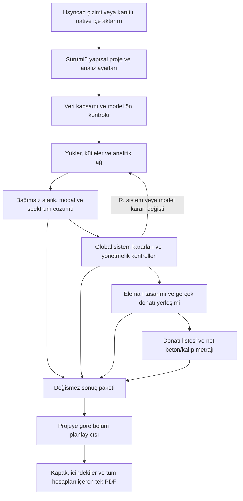

# Hsyncad - Bağımsız betonarme analiz, gerçek metraj ve birleşik statik rapor uygulama planı

**Tarih:** 5 Kasım 2026  
**Uygulayıcı:** Kullanıcının seçtiği GPT 6.1 Sol / High  
**Durum:** Araştırmaya dayalı uygulama planı. Bu dosyanın hazırlanması, aşağıdaki geliştirme aşamalarının uygulanmış olduğu anlamına gelmez.  
**Uygulama deposu:** `C:\Users\hsyn\Desktop\muhendis-mimar-portali`  
**Zorunlu REA deposu:** `C:\Users\hsyn\Desktop\hsyncad\rea`  
**Bu planın inceleme kanıtları:** `C:\Users\hsyn\Desktop\hsyncad\incelemeler\statik-rapor-plan-2026-11-05`

## 0. Kullanıcının kesinleştirdiği hedef ve kararlar

Kullanıcı Hsyncad'de, gerçek bir betonarme projenin geometrisi, yükleri, malzemeleri, analiz ayarları ve seçilmiş donatıları üzerinden, projeye uygulanabilir TBDY 2018 ve TS 500 kontrollerini hesaplayan ve neden-sonuç ilişkisiyle açıklayan bir statik hesap raporu istiyor. Hedef, mühendis tarafından incelenip imzalanarak ilgili kuruma sunulabilecek teknik dosyayı hazırlamak. Sayfaya yönetmelik adı ve yeşil onay işareti basmak bu hedefi karşılamaz.

Sonradan sorulan sorulara verilen cevaplar bu planın bağlayıcı kapsamıdır:

1. **Hsyncad ideCAD'den bağımsız çalışacak.** Son kullanıcı bilgisayarında ideCAD kurulumu, açık ideCAD oturumu, ticari ideCAD lisansı veya REA bulunması rapor üretiminin koşulu olmayacak. REA geliştirme ve doğrulama aracıdır; ürünün hesap motoru değildir.
2. **REA reposu kesinlikle kullanılacak.** Native veri yerleşimi, analiz ayarı anlamları, donatı ve rapor veri yolları, uygun kapsamlı REA incelemeleriyle araştırılacak. Sadece eski sohbeti veya README'yi okumak bu şartı yerine getirmez.
3. **İlk tam teslim betonarme bina statik raporu ve gerçek metrajdır.** Cephe iskelesi ve kalıp iskelesi hesapları sonraki kapsamdır. Verilen iskele örnekleri ayrı bir gelecek iş paketi olarak kaydedilecek; ilk teslimin tamamlanmasını bunlar bekletmeyecek.
4. **Tek ana PDF üretilecek:** gerçek proje kapağı + otomatik içindekiler + genel bilgiler + analiz ve yönetmelik kontrolleri + eleman hesapları + temel/merdiven + metraj eki. Ayrı kapak PDF'si hazırlatılmayacak. Metrajın CSV/JSON gibi ek veri çıktıları isteğe bağlı olabilir.
5. **Zemin etüt dosyası şu anda yok.** Kullanıcı analiz ayarlarına mühendislik parametrelerini kendisi girebilecek. Zemin etüt PDF'si yüklemek, bu girdilerle analiz yapmanın zorunlu ön koşulu yapılmayacak. Yazılım girilen değerin kaynağını ve hangi geoteknik konuların değerlendirilmediğini açıkça kaydedecek.
6. Kullanıcının verdiği **Analiz Ayarları > Temel - Zemin** ekran görüntüsü somut arayüz ve veri sözleşmesi referansıdır; Bölüm 4'te alan alan işlenmiştir.
7. Kullanıcı uygulamayı başlattıktan sonra bilgisayar başından ayrılacak. Aşamalar arasında rutin onay veya "devam" istenmeyecek. Kalıcı durum kaydı, sınırlı tekrar, zaman aşımı ve güvenli yeniden başlama zorunludur.

### 0.1 Başarı tanımı

- Raporda görünen her sayı; model girdisine, hesap adımına, gerçek analiz sonucuna veya açıkça belirtilmiş kullanıcı girdisine kadar izlenebilir.
- Gerekli kontroller eleman, kat, yön, yükleme, kombinasyon ve yönetmelik koşuluna göre otomatik seçilir.
- Veri yoksa veya çözüm desteklenmiyorsa sonuç `uygun` olmaz. Eksik bölüm sessizce kaybolmaz.
- Uygulanmayan kontrolün gerekçesi görünür; projede bulunan fakat çözülemeyen bir eleman `uygulanmaz` sayılmaz.
- Gerçek bir başarısız hesap, raporda başarısız olarak yer alır. Raporun sayısal olarak tamamlanması, yapının bütün kontrolleri sağladığı anlamına gelmez.
- Kullanıcıdan gerçek imza/onay alınmadan `E-İMZALIDIR`, `Resmi Onay Belgesidir`, kurum onayı veya mühendis onayı üretilmez.
- Verilen üç betonarme örnek, ayrıca sıfırdan oluşturulmuş bağımsız projelerle doğrulanır. Dosya adının veya proje sahibinin kimliği hesabı değiştiremez.

### 0.2 Kapsam sınırı

İlk destek zarfı: yeni, yerinde dökme betonarme binalar; çerçeve/perde/karma sistemler; kirişli ve ilgili kontrolleri gerçekten uygulanmış diğer döşeme tipleri; tekil/sürekli/radye temeller; parametrik betonarme merdivenler. Üç referans projedeki bodrum, yarı rijit diyafram, boşluklu döşeme, perde ve radye gereksinimleri ilk tam teslimin içindedir.

Çelik iskele, kalıp iskelesi, yığma, ahşap, prefabrik, öngerme, kazık, yüksek bina, deprem yalıtımı ve mevcut bina performans/güçlendirme işlemleri ayrı destek profilleridir. Böyle bir nesne veya tasarım yaklaşımı tespit edilirse destek durumu açıkça bildirilir; betonarme bina kurallarıyla sonuç uydurulmaz. TBDY'nin bütün bina türlerini bu ilk teslimin desteklediği söylenmez.

## 1. Bu plan hazırlanırken gerçekten ne incelendi?

### 1.1 Antigravity konuşması

Okunan konuşma kimliği: `dc49ea3b-8c7f-459e-8f23-07c8f3728fa3`.

Dar kapsamlı kaynak:

`C:\Users\hsyn\.gemini\antigravity\brain\dc49ea3b-8c7f-459e-8f23-07c8f3728fa3\.system_generated\logs\transcript.jsonl`

Kayıt 670 JSONL satırı ve yaklaşık 836 KB. İlgili kullanıcı mesajları ile native yazıcıya ilişkin sonuç mesajları okundu. Tarihsel sohbet, CRC ve kendi parser'ında round-trip üzerinden "gerçek native yazıcı tamamlandı" iddiasında bulunuyor. Güncel `NATIVE_INTEROP_STATUS.md` ve kod bunun genel native uyumluluğu kanıtlamadığını açıkça belgeliyor. **Eski sentezleyici veya donor kopyalama yolu geri getirilmemeli.** Önceki konuşmadaki geniş yetki ifadeleri bu yeni görevin bağımsız izinleri sayılmamalı.

### 1.2 İncelenen kaynak dosyalar

| Kimlik | Kaynak klasör | Ana hesap raporu | "Kapak" dosyası | Metraj |
|---|---|---:|---:|---:|
| MS1 | `D:\IDM_DOWNLOAD\MUSTAFA SELVİ TÜM PROJELER\STATİK\1.kısım` | 606 sayfa | 4 sayfa | 4 sayfa |
| MS2 | `D:\IDM_DOWNLOAD\MUSTAFA SELVİ TÜM PROJELER\STATİK\2.kısım` | 311 sayfa | 3 sayfa | 4 sayfa |
| SK | `D:\IDM_DOWNLOAD\SÜHEYLA KARA PROJELER\STATİK` | 954 sayfa | 3 sayfa | 4 sayfa |

Üç ana rapor **1.871 sayfa**. Ayrıca SK iskele raporu 70, kalıp iskelesi raporu 28 sayfa. Toplam **11 PDF / 1.991 sayfa** envantere alındı ve sayfa sınırları korunarak metin çıkarıldı. Ana raporların bölüm dizinleri, metrajların tüm sayfaları ve seçilmiş kritik hesap sayfaları incelendi. Yedi temsilî sayfa Poppler ile PNG'ye çevrilip görsel olarak kontrol edildi. Bu işlem, 1.871 sayfanın her hesabının bağımsız mühendislik doğrulaması yapıldı anlamına gelmez.

**Önemli ayrıntı:** Örneklerde "STATİK RAPOR KAPAK" diye adlandırılan PDF'ler esas olarak içindekiler/bölüm dizinidir. Hedef ürün bunları körlemesine birleştirmeyecek; gerçek bir proje kapağını ve doğru sayfa bağlantılı içindekileri kendisi üretecek.

Özgün `.ide10` dosyaları ve paftalar da hash envanterine alındı. Downloads kopyası ile MS1 kaynak klasöründeki dosya bayt eşit:

| Dosya | Boyut | SHA-256 |
|---|---:|---|
| MS1 `.ide10` ve Downloads kopyası | 145.671.130 B | `0095778181794af8f4f8cfb52cabcca3dda4fc098cb3ea33a90e5c659bdaf325` |
| MS2 `.ide10` | 48.753.119 B | `0a4400a0a1d499d8fce98860fef3e8145c43d5925ee535bf9cb54017a5cbaf90` |
| SK `218 ada 50 parsel STATİK.ide10` | 74.359.398 B | `de92fa251e51912d212281f0d1cfe8ee13f7474b703a4e6c3cc91aa88aef8b2b` |
| SK iskele native örneği | 44.739.331 B | `5bb42a75ee45081adc97913064e6b7a92c40e01fa3c9b64640761e1015625207` |

### 1.3 Metraj incelemesinin somut sonucu

Aşağıdakiler **kaynak PDF'de basılı değerlerdir**, Hsyncad'in bağımsız hesap sonucu değildir:

| Proje | Ayrıntılı beton toplamı, m³ | Kalıp, m² | İnce donatı, kg | Kalın donatı, kg | Genel donatı, kg |
|---|---:|---:|---:|---:|---:|
| MS1 | 1.334,015 | 6.681,91 | 61.412,19 | 56.009,75 | 117.421,93 |
| MS2 | 633,099 | 3.194,33 | 28.275,14 | 26.874,08 | 55.149,22 |
| SK | 1.873,479 | 9.680,89 | 79.331,95 | 82.737,88 | 162.069,83 |

Basılı kat toplamları yeniden toplandı:

| Proje | Kalıp kat toplamları - basılı genel toplam | Beton kat toplamları - basılı genel toplam | İnce + kalın - basılı donatı toplamı |
|---|---:|---:|---:|
| MS1 | -0,01 m² | +0,001 m³ | +0,01 kg |
| MS2 | 0,00 m² | +0,001 m³ | 0,00 kg |
| SK | +0,01 m² | -0,001 m³ | 0,00 kg |

Bu küçük farklar, alt satırların ve genel toplamın ayrı hassasiyetlerde yuvarlanmasıyla uyumludur. Ham hassasiyetli ideCAD hesapları çözülmeden kesin nedenleri ispatlanmış sayılmaz. Yeni sistemin kuralı: **önce ham değerleri topla, sonra gösterimde yuvarla**; kaynak kıyasında basılı sayının temsil ettiği yuvarlama aralığını kullan. Bu farkları gidermek için proje geometrisini veya donatısını ölçekleme.

Metraj PDF'leri donatıyı kat/eleman grubu/çap/ince-kalın biçiminde ayırıyor. MS1'de bant kiriş ve merdiven donatısı da var. SK, kolonları ve farklı çapları kapsayarak ikinci önemli kontrol ailesini oluşturuyor. Yalnız genel toplamları tutturmak yeterli değildir; yanlış elemanların birbirini götürmesi engellenmelidir.

**Bu aşamada kesinleştirilmeyen:** Gerçek native donatı/kesim listesi tam çözülmediği ve bazı geometriler hesap modeline taşınmadığı için bu üç projenin metrajı Hsyncad'de bağımsız olarak doğrulanmış değildir. Aşağıdaki plan bu açığı kapatmayı hedefler.

### 1.4 Güncel kodda doğrulanan sorunlar

Araştırma başlangıcında yerel `main` HEAD: `6ffc5050386fc2ae8d99da1c3325b3cfe065ee07`. Çalışma ağacında kullanıcıya ait çok sayıda değiştirilmiş ve izlenmeyen Hsyncad dosyası vardı. Bu plan kaynak kodu değiştirmedi; uygulama başlangıcında durum yeniden alınmalıdır.

Plan teslim kontrolünde başka mevcut çalışma `9c928242b14219e6818ce2cf558db222d2c2fad7` checkpoint'ine ilerlemişti. Yeni kısa çalışma kaydı okundu; native/düzenleyici probe'u bu güncel ağaçta yeniden çalıştırıldı ve aşağıdaki sayılar aynı çıktı. `quantities.ts`, `reports.ts`, `analysis.ts`, `fem-solver.ts` ve `design-engine.ts` için başlangıç HEAD'ine göre değişiklik bulunmadı; burada raporlanan sabit sonuç/rapor açıkları son kontrolde de mevcut. Başka çalışmanın commit/push veya testleri bu plan oturumunun işlemi değildir.

| Konu | Gözlenen mevcut durum | Uygulama kararı |
|---|---|---|
| Sabit referans metrajı | `quantities.ts:221-350`, proje adı/altı kat/kat adları eşleşince `CERTIFIED_METRAJ_REFERENCE` döndürüyor; eleman paylarını referans toplamlarından dağıtıyor | Üretim yolundan kaldır. Referans sayıları yalnız bağımsız test verisi olsun |
| Sahte eşleşme denemesi | Altı kat tanımı ve tek 4×4×0,15 m döşemeden oluşan 2,4 m³ model 1.334,015 m³ döndürdü. Kalınlık iki katına çıkarılınca sonuç değişmedi; yalnız adı değiştirince 4,8 m³ oldu | Ad bağımsızlığı, geometri mutasyonu ve toplam korunumu testleri zorunlu |
| Testin üretim sabitini doğrulaması | `m5-reporting.test.ts`, küçük örnek modelle aynı üretim sabitlerini bekliyor | Bu testler hesap doğruluğunun kanıtı sayılmayacak; bağımsız oracle ile değiştirilecek |
| Rapor örnek sayıları | `reports.ts` içinde sabit modal katılımlar, öteleme/düzensizlik/ikinci mertebe değerleri, örnek temel ve eleman satırları var | Eksik veride örnek satır/fallback sayı yasak |
| Yanlış olumlu sonuç | `reports.ts:631-640` özetinde sabit `UYGUN`, `TÜM SINIRLAR SAĞLANDI` ve `GÜVENLİ (PASS)` bulunuyor | Özet yalnız gerçek kontrol kayıtlarından türetilecek |
| Eleman kırpılması | `reports.ts:940,982,1036,1082,1137,1171`: ilk 10 eleman/birleşim; modlarda ilk 9 satır | Tam raporda bütün kapsam; sayfa sayısı dinamik. Özet ayrıdır |
| İmza/onay metni | `reports.ts:217,406`: `Resmi Onay Belgesidir`, `E-İMZALIDIR` | Gerçek imza iş akışı olmadan kaldır |
| Proje kimliği | Varsayılan mühendis/konum/tarih/sınıflar MS1'e sabit. Rapordaki ilçe ve BKS/DTS/BYS ile de uyuşmuyor | Projeye ait zorunlu metadata ve doğrulanmış türetimler |
| Modal çözüm | `fem-solver.ts:1052-1177`: X yönünde indirgenmiş kat modeli, en çok 3 mod; Y/RZ katılımı sabit; periyotlar ampirik aralığa kırpılıyor | Gerçek 3B özdeğer problemi ve yeterli mod; ham özdeğer korunacak |
| Çözüm hatası | `analysis.ts:590` çevresinde FEM hatası yakalanıp yaklaşık yola dönülebiliyor | Nihai analizde tanılanan solver hatası; sessiz yaklaşık başarı yok |
| Yük aktarımı | Kat yüklerini kirişlere basitleştirilmiş dağıtım ve varsayılan G/Q değerleri var | Gerçek panel/yük yolu ve açık yük anlamı |
| Temel hesabı | `foundations.ts` qmin'i sıfıra kırpıyor; `design-engine.ts` depremde zemin değerini genel 1,5 çarpanla artırıyor | Temas ve dayanım türü açık; kaynaksız çarpan/kırpma yok |
| Genel metraj | Rastgele proje yolunda döşeme/radye/merdiven donatısı sabit çap ve kg/m² benzeri kabullerle üretilebiliyor | Tahmini ön metraj ayrı etiketlenir; gerçek donatı metrajı yerleşmiş donatıdan hesaplanır |

Bu bulgular, bütün mevcut modüllerin işe yaramaz olduğu anlamına gelmez. Geometri, native kaynak koruma, birleşim hacmi, IFC ve mevcut sayısal modüller kendi kanıtlarıyla değerlendirilecek; doğrulanan parçalar korunacak.

### 1.5 Native okuyucu ve düzenleyici arasında ölçülen kapsam kaybı

Bu oturumda güncel `parseIde10` ve `importIdeWorkspace` gerçekten çalıştırıldı:

| Kaynak | Okunan kat | Tanınan kayıt | Düzenleyiciye taşınan | Referans olarak kalan | Native G/Q okunan döşeme | Düzenleyiciye G/Q taşınan |
|---|---:|---:|---:|---:|---:|---:|
| MS1 | 6 | 1.273 | 928 | 345 | 159 | 0 |
| MS2 | 5 | 686 | 532 | 154 | 70 | 0 |
| SK | 7 | 2.171 | 1.986 | 185 | 299 | 0 |

Tanınan kayıt sayısı aks/çizgi/kesit gibi hesap dışı kayıtları da içerir; tamamı taşıyıcı eleman değildir. Referans olarak kalanlar arasında da mimari duvar/çizgi gibi hesap dışı nesneler vardır. Sayıların tamamı "eksik taşıyıcı" diye yorumlanmayacak. Her nesne rolüne göre sınıflandırılacak.

Önemli açıklar: boşluklu döşeme aktarımı, bant kiriş, merdiven ağı, temel rolünün korunması, fiziksel malzeme bilgileri ve yüklerin hesap modeline taşınması. İçe aktarılan malzeme şu anda `IDE malzemesi · yeniden tanımlayın`. Bunu sessiz C30/B420C yapmak yanlış olur. Native yükün `tf/m²` olması ve öz ağırlık içerip içermemesi ayrıca çözümlenmelidir.

SK iskele native örneği bugünkü okuyucuda "doğrulanmış taşıyıcı eleman geometrisi okunamadı" hatası verdi. Bu gerçek negatif sonuçtur; iskele desteği varmış gibi raporlanmayacak.

## 2. Örnek raporların mühendislik mantığı

Rapor sırası şu veri akışını izliyor: yapı tanımı -> yük/malzeme/rijitlik -> deprem ve analiz yöntemi -> global kontroller -> eleman kuvvetleri -> eleman tasarımı -> temel ve merdiven -> sonuç. Yeni rapor bu mantığı izlemeli; sabit 19 bölüm şablonuna sıkışmamalıdır.

### 2.1 MS1'in karar zincirinden alınan dersler

- Basılı sayfa 8: Yozgat/Akdağmadeni, 368 ada 2 parsel; 6 kat; BKS 3, DTS 3, BYS 7; C25/B420C; ZB; DD-2 `SDS=0,3861`, `SD1=0,1144`.
- Sayfa 14-16: **yarı rijit diyafram ve temel-üst yapı etkileşimi seçili**. Bu projeyi yalnız rijit kat diyaframlı çubuk modelle çözüp eşdeğer kabul etmek doğru değildir.
- Sayfa 36: üst yapı ve bodrum için ayrı modal yeterlilik; üst yapıda 6 modla X %97,21, Y %98,10 kümülatif katılım gösteriliyor. Bunlar fixture hedefidir; başka projelere kopyalanmaz.
- Sayfa 37-43: A1/B1 varlığı ile seçilen yöntemin uygunluğu ayrı kavramlardır. A1'in görülmesi otomatik çökme demek değildir; dinamik analiz yapılması da ilgili bütün kontrol ve sonuçların kaldırılması demek değildir.
- Sayfa 38/42: girilen R=6 ile kullanılan yaklaşık 4,68 farklı. R seçim nedeni, zayıf kat kararı ve bunun analiz sonuçlarına geri etkisi raporlanıyor. Programın otomatik kararı gerekiyorsa yeniden analiz ve bağımlı tasarımlar da güncellenmelidir.
- Sayfa 73-74: bazı diyafram kontrolleri döşeme tipi ve A2/A3 koşullarına bağlı. Koşul yokken satır üretmek yerine neden uygulanmadığını açıklamak gerekir.
- Sayfa 96-165 ve 290-360: bodrumlu binalara ait tasarım kuvvetleri ayrı işleniyor. Üst yapı/bodrum etkilerini tek sabit çarpana indirgememek gerekir.
- Sayfa 464-562: radye ağ bilgileri, mesnet yükleri, düğüm basınçları, donatı ilaveleri ve zımbalama var. Bir tek `N/A ± M/W` hesabı bu içeriğin yerine geçmez.
- Sayfa 563-606: farklı merdiven aileleri için kol/sahanlık yük, analiz ve donatı hesapları var. Basamaklı gerçek geometri ve yük yolu gereklidir.

### 2.2 SK neden zorunlu ikinci bağımsız kabul projesidir?

SK, MS1'den farklı olarak gerçek kolon tasarımı ve kolon-kiriş birleşimlerini belirgin biçimde kapsıyor:

- Sayfa 12: A15 taşıyıcı sistem, R=7; A1 düzensizliği ve farklı ikinci mertebe sınırı.
- Sayfa 29-30: 15 moda kadar uzanan modal rapor; son kümülatif X/Y katılımları yaklaşık %97,58/%97,51. Sabit üç mod yaklaşımı elenir.
- Sayfa 38: bağ kirişi bağlılık derecesi; sayfa 39 perde devrilme değerlendirmesi.
- Sayfa 485-778: kolon ön bilgileri, bodrum tasarım kuvvetleri, N-M2-M3, enine donatı, burkulma/moment büyütme, kesme, güçlü kolon ve eksenel sınırlar.
- Sayfa 842-862: kolon-kiriş birleşim kesme güvenliği.
- Sayfa 941-954: kolon etkileri/kontrolü ve sürtünme kesmesi.

Örneklerde çok uzun periyotlu ve çok düşük etkin kütleli mod satırları da bulunuyor. Bunların kaynağı araştırılmadan yeni sistemde taklit edilmez veya gizlice silinmez. Mekanizma, sıfır kütleli serbestlik, numerik mod ve fiziksel mod ayrımı artık/residual ve etkin kütle kanıtıyla yapılır.

### 2.3 Her kontrolün anlatım sözleşmesi

Her hesap ailesi şu altı soruyu cevaplamalı:

1. **Neyi kontrol ediyor?** Örneğin kirişte kesme dayanımı veya kolonun iki eksenli taşıma gücü.
2. **Neden bu projede gerekli?** Eleman rolü, süneklik, döşeme/diyafram tipi, DTS/BYS veya geometrik koşul.
3. **Hangi girdilerle?** Kesit, malzeme, donatı, kat, açıklık, gerçek kombinasyon ve istasyon.
4. **Nasıl hesaplandı?** Formül/algoritma kimliği, birimler, ara büyüklükler, kaynak madde ve geçerlilik alanı.
5. **Ne çıktı?** Hesaplanan değer, sınır/kapasite, kritik yön ve sayısal karşılaştırma.
6. **Sonuç ne gerektiriyor?** Sağlandı/sağlanmadı, yöntem değişikliği, yeniden analiz, uygulanmama gerekçesi veya gerekli kullanıcı verisi.

Mühendislik anlatımı deterministik şablonlardan ve gerçek `CheckResult` kayıtlarından üretilecek. Ürünün çalışması sırasında bir LLM'nin sayıları veya yönetmelik kararlarını yazmasına ihtiyaç olmayacak.

## 3. Zorunlu REA araştırma paketi

### 3.1 Kimlik ve mevcut hazır oluş

5 Kasım 2026'da doğrulanan yerel REA repo HEAD:

`113679c9a6a1af4c77c1b546e466f4d490dc1095`, paket `rea-agents 6.7.0`, origin `https://github.com/morluto/rea.git`.

Repo temiz `main`; `node_modules` ve `dist` henüz yok. `scripts\rea.mjs` kaynak akışı için `npm ci` ve `npm run build:cached` istiyor. **Repo CLI şu anda kurulmuş/hazır diye yazılmayacak.**

Canlı Codex REA MCP bağlantısı mevcut, fakat npm global kopyasından çalışıyor:

`C:\Users\hsyn\AppData\Roaming\npm\node_modules\rea-agents\scripts\rea.mjs`

`binary_session({})` gerçek gözleminde hedef açık değildi. Ghidra provider `not_configured` dedi; bu MCP sürecinde `GHIDRA_INSTALL_DIR` ve `JAVA_HOME` yoktu, çıplak `java.exe` için mutlak yol hatası görüldü. Buna karşılık diskte mevcut kurulumlar dar okumayla doğrulandı:

- Ghidra: `C:\ghidra\ghidra_12.1.4_PUBLIC`
- JDK: `C:\Program Files\Microsoft\jdk-21.0.12.101-hotspot`

Eski Antigravity oturumundaki "healthy" ifadesi bu Codex sürecinin hazır oluşunu kanıtlamaz. Geliştirme başında repo/runtime/provider kimlikleri ve yetenekleri tekrar ölçülecek.

### 3.2 REA için önce okunacak kaynaklar

- `C:\Users\hsyn\.agents\skills\reverse-engineer-anything\SKILL.md`
- `C:\Users\hsyn\Desktop\hsyncad\rea\AGENTS.md`
- Aynı repoda `README.md`, `docs\windows-ghidra-p0.md`, `docs\native-investigation.md`, `docs\cli.md`.
- Uygulama deposunda `docs\hsyncad\IDE_FORMAT_MAP.md`, `NATIVE_INTEROP_STATUS.md`, `IDECAD_DESKTOP_WORKFLOW.md`.

REA repo geliştirmesine gerek yoksa repo değiştirilmez. Bu görev REA'nın sağlayıcı kapsamını büyütme, EXE patch'leme veya lisans korumasını atlatma talimatı değildir. Kullanıcının kişisel kullanım hedefi, donatı/ayar/rapor veri yapılarının yerel incelenmesini ve bağımsız yeniden uygulamayı kapsar.

### 3.3 Çalışır REA yolu: kullanıcı yokken takılmayan hazırlık

1. Mevcut bağlı MCP ve kayıtlı Evidence kullanılabiliyorsa aynı incelemeyi tekrarlama.
2. Önce Node/npm uyumunu doğrula. Bu oturumun düz `node` komutu **24.15.0**, npm **11.12.1**; yerel REA repo `.nvmrc` **24.22.1**, engines **`^22.23.4 || ^24.22.1 || >=26.12.1`**, packageManager **npm@11.16.0** bildiriyor. Global kurulu 6.7.0 paketinin engines aralığı repo checkout'undan farklı; sadece sürüm adının eşitliği aynı build değildir. Uyumlu mevcut Node yolu gerçekten doğrulandı: `C:\Users\hsyn\.cache\codex-runtimes\codex-primary-runtime\dependencies\node\bin\node.exe` -> **v24.22.1**. npm 11.16.0 hazır kurulu varsayılmayacak; gerekirse global yükseltme yapmadan görev için sürümlü npm paketi seçilecek ve gerçek sürümü ölçülecek.
3. Repo kurulumu/derlemesinde **çalışma dizini veya `--prefix` açıkça REA reposunu hedefleyecek**. Uygulama reposunda yanlışlıkla `npm ci` çalıştırma. Uyum kapısından sonra `npm --prefix 'C:\Users\hsyn\Desktop\hsyncad\rea' ci` ve aynı prefix ile `run build:cached` eşdeğeri kullan; gerçek Windows kapılarını atlama.
4. Bu görev için başlatılan PowerShell/alt süreç ortamında aşağıdaki değerleri ver; sistem veya kullanıcı ortamını kalıcı değiştirme. Aşağıdaki doğrudan doctor komutu Node yolu doğrulanmış bir örnektir; repo bağımlılık/build hazırlığı yapılmadan çalışır kabul edilmez:

```powershell
$env:GHIDRA_INSTALL_DIR = 'C:\ghidra\ghidra_12.1.4_PUBLIC'
$env:JAVA_HOME = 'C:\Program Files\Microsoft\jdk-21.0.12.101-hotspot'
$env:REA_ANALYSIS_PROVIDER = 'ghidra'
& 'C:\Users\hsyn\.cache\codex-runtimes\codex-primary-runtime\dependencies\node\bin\node.exe' 'C:\Users\hsyn\Desktop\hsyncad\rea\scripts\rea.mjs' doctor --client codex --json
```

Bu yolun mutlak Java yolu üretmesi REA `GhidraInstallation.ts` kaynak koduyla doğrulandı; bu plan oturumunda native provider yeniden başlatılıp denenmedi. Uygulayıcı bunu gerçek çalışma kabulüyle tamamlayacak. Alt süreçte verilen ortam, zaten açık MCP server'ının ortamını kendiliğinden değiştirmez.

Sürümlü npm için global kurulumu değiştirmeyen somut hazırlık örneği aşağıdadır. İlk npm bootstrap dosyası ve uyumlu Node yolu bu oturumda doğrulandı; npm 11.16.0 edinme/kurulum/build komutları bu plan oturumunda çalıştırılmadı. Uygulayıcı önce npm sürüm çıktısını ve alt süreç Node kimliğini doğrulayacak; sonra kuruluma geçecek:

```powershell
$reaProjectRoot = 'C:\Users\hsyn\Desktop\hsyncad\rea'
$reaNodeExe = 'C:\Users\hsyn\.cache\codex-runtimes\codex-primary-runtime\dependencies\node\bin\node.exe'
$reaNpmBootstrap = 'C:\Program Files\nodejs\node_modules\npm\bin\npm-cli.js'
$env:PATH = (Split-Path -Parent $reaNodeExe) + ';' + $env:PATH
& $reaNodeExe $reaNpmBootstrap exec --yes --package=npm@11.16.0 -- npm --version
& $reaNodeExe $reaNpmBootstrap exec --yes --package=npm@11.16.0 -- node --version
& $reaNodeExe $reaNpmBootstrap exec --yes --package=npm@11.16.0 -- npm --prefix $reaProjectRoot ci
& $reaNodeExe $reaNpmBootstrap exec --yes --package=npm@11.16.0 -- npm --prefix $reaProjectRoot run build:cached
```

Bu örnekte `npm exec` ağdan sürümlü paketi npm önbelleğine indirebilir. Komutların her biri timeout/log sahibi runner içinde ayrı yürütülür; sürüm veya kurulum kapısı başarısızsa sonraki komut körlemesine çalıştırılmaz.

5. Repo checkout'unda eksik Windows native bağımlılığı varsa, aynı sürümün çalışan resmî paket runtime'ını kaynak repo/sürüm/build bağı kaydıyla kullanmak mümkündür. "Repo kullanımı" yine gerçek kaynak incelemesi + somut REA analiz/evidence çıktısı gerektirir. Uygun toolchain bulunamazsa kurulum yapılmış gibi davranma; sınırlı fallback ve bağımlı engeli kaydet, bağımsız işleri sürdür.
6. Kalıcı MCP yapılandırması gerçekten gerekirse önce dry-run hazırlanır. `reverse-engineer-anything` SKILL.md ve REA AGENTS.md açık kuralı: **"rea setup must show its planned changes and require approval before writing files or installing Hopper."** Kullanıcı yokken bu onay varsayılmaz; **process-scoped CLI yolu ve mevcut kanıtlarla bağımsız işler sürdürülür.**
7. Hedef açılışı/analizi zaman aşımı ve temizlik sahibi olan görevle yürütülür. Dökümü başlatıp sonsuza kadar bekleme. Kendi oturumunun kanıtını dışa aktarıp kendi oturumunu kapat; başka açık kullanıcı oturumunu kapatma.

### 3.4 Yeniden kullanılacak mevcut yerel kanıt

Kök: `C:\Users\hsyn\Desktop\hsyncad\incelemeler\idecad-rea`.

Öncelikli alt klasörler: `native-2026-11-04\document-records`, `storey-entities`, `entity-dispatch`, `storey-reader`, `compressed-carrier`; döşeme yükleri için `ide10-2026-10-28\plan-metadata-findings-2026-10-29.md`.

Güncel kurulu ideCAD EXE SHA-256 yeniden ölçüldü:

`C:\Program Files\ideCAD\ideCAD Statik 11 Deneme\ideCAD_Statik_11_Deneme.exe`

`350d5a581417dec9cddac52b66e1a4b60ecdce227e70eb93cb909b6f660162f4`.

Eski arşiv README'sindeki başka EXE hash'i ve adres haritası yeni EXE'ye doğrudan uygulanmayacak. Kimliği eşleşen kanıtlarda başlangıç adayları: belge okuyucu `0x14098b600`, belge yazıcı `0x140989c30`, kat yazıcı `0x1409c8330`, koleksiyon yazıcı `0x1408eb940`, tür fabrikası `0x1409441c0`. Bunlar yeniden bağlanacak araştırma adresleridir; bütün native gramerin çözülmüş olduğu iddiası değildir.

### 3.5 REA ile cevaplanması zorunlu sorular

| İş | Soru | Beklenen somut çıktı |
|---|---|---|
| R1 | Malzeme sınıfları, fiziksel dayanımlar ve eleman-malzemesi ilişkisi nerede saklanıyor? | Sürüm/kayıt sınıfı/alan/birim eşlemesi; üç gerçek örnekte kontrol |
| R2 | G/Q, öz ağırlık, duvar/çizgi/nokta yükleri nasıl ayrılıyor? | Yük semantiği, sayısal kodlama, birim ve yük yolu eşlemesi |
| R3 | Kullanıcı ekranındaki temel-zemin, diyafram, bodrum ve deprem ayarları nasıl okunuyor? | Ayar -> serialize alanı -> analizdeki tüketici -> rapor satırı zinciri |
| R4 | Kolon/kiriş/perde/döşeme/radye/merdiven donatı kayıtları hangi nesneye bağlı? | Donatı türü/çap/adet/aralık/bölge/kanca/ek/ilave tablosu; çözülemeyen alanların kaydı |
| R5 | Eleman kuvvetleri ve tasarım sonuçlarının kimlikleri rapora nasıl bağlanıyor? | Kat+nativeId+eleman+yön+kombinasyon+istasyon korelasyonu |
| R6 | Statik rapor seçim ve bölüm ekleme mantığı neye göre dallanıyor? | Bölüm koşulları, kapsam kararları ve kaynak veri haritası |
| R7 | Beton/kalıp/donatı metrajının ölçüm sözleşmesi ne? | Net/brüt paylaştırma, temas yüzleri, donatı boyları ve yuvarlama kanıtı |
| R8 | Native dosyada kayıtlı analiz/donatı modelin son haliyle güncel mi? | Sonuç/model ilişkisi, bilinen tek-alan değişikliği denemesi; güncellik belirsizse açık durum |

Yöntem: ilgili string/procedure araması -> xref/call path -> yalnız ilgili fonksiyon pseudocode/assembly -> nesne okuyucu/yazıcı ve alan kullanımı -> kontrollü karşılaştırma. PE diyalog kaynakları alan ve komut keşfi sağlar; bir checkbox'ın hesapta etkili olduğunu tek başına kanıtlamaz. Tek dev EXE dökümü veya sürekli aynı Ghidra analizini başlatmak yasaktır.

Her çözülen alan için: dosya SHA-256, EXE SHA-256, provider/runtime sürümü, Evidence ID, kayıt sınıfı ve sürüm koşulu, byte aralığı, endian/sayısal kodlama, birim, native eleman kimliği, okuyucu/yazıcı fonksiyonu ve gözlem/çıkarım ayrımı tutulur. Yakındaki makul bir float'ı yük veya donatı diye kabul etme.

**REA kabul kapısı:** en az malzeme, yük, analiz ayarı ve donatı/rapor bağlama konularında yeni veya kimliği yeniden doğrulanmış somut Evidence; gerçek fixture ve bozuk-kayıt sınamaları; açık unknown listesi. Salt REA tool çağrısı, `doctor PASS`, CRC veya kendi parser'ında round-trip bu kapıyı geçirmez. REA bulgusu bağımsız hesapta doğrulanmadan yönetmelik kuralı haline gelmez.

R1-R8'in **her biri** `answered / partial / unresolved`, bağlı Evidence ve etkilediği özelliklerle kapatılacak. Bu sınıflama araştırma görevini izler; `partial/unresolved` işlevsel kabul demek değildir. Özellikle R7 metraj ölçüm sözleşmesi ve R8 kayıtlı sonucun güncelliği çözülmeden o veriye dayalı gerçek referans metrajı/analiz eşdeğerliği onaylanamaz; çözülemeyen veri kullanımı açıkça engellenir. Bağımsız Hsyncad projesinde yeni hesap üretimi ayrı yetenek olarak ilerleyebilir.

Gerekli kalıcı çıktılar: `REA_FINDINGS.md`, `REA_UNKNOWN_LEDGER.json`, `native-field-map.json`, `rea-identity-manifest.json` ve taşınabilir Evidence bundle. Büyük/özel dosyalar yerel Hsyncad kanıt klasöründe kalır.

## 4. Kullanıcının ekran görüntüsünden analiz ayarları sözleşmesi

Kalıcı kopya:

`C:\Users\hsyn\Desktop\hsyncad\incelemeler\statik-rapor-plan-2026-11-05\kullanici-analiz-ayarlari-temel-zemin.png`

SHA-256: `0c70e56e8e93362492deb6fc226b15ce78da6999516232bd0cb3531ee584ed39`.

### 4.1 MS1 için kullanıcı tarafından sağlanmış gerçek parametreler

| Görünür alan | Ekrandaki değer | İç modelde anlamı |
|---|---:|---|
| Kuru toprak birim ağırlığı | 2,1 tf/m³ | `dryUnitWeight`; birim ağırlıktır, kütle yoğunluğu değildir |
| Suya doygun toprak birim ağırlığı | 2,5 tf/m³ | `saturatedUnitWeight` |
| Zemin tipi | Kohezyonsuz | Geoteknik davranış sınıflaması; TBDY yerel zemin sınıfı ZB ile aynı alan değildir |
| Yatak katsayısı | 3.080 tf/m³ | `subgradeModulus`; zemin gerilmesi/deplasman ilişkisi |
| Temel taşıma gücü tasarım dayanımı (qt) | 55 tf/m² | **Tasarım dayanımı**; otomatik olarak eski yöntem emniyet gerilmesi sayılmaz |
| Temel kontrolünde ortalama gerilme | Seçili | Temeller için kontrol tabanı; kuralın geçerliliği ayrıca yönetmelik profiliyle doğrulanır |
| Temel kontrolünde deprem yüklemeleri | Seçili | İlgili gerçek deprem kombinasyonları hesaba katılır |
| Temellerde negatif taşıma gücü kontrolü | Seçili | Negatif temas basıncı/temas kaybı tanılanır; sıfıra kırpılarak gizlenmez |
| Radye kontrolünde ortalama gerilme | Seçili | Radye için ayrı tercih; qmin/qmax da raporlanır |
| Kirişsiz radyede deprem yüklemeleri | Seçili | İlgili kombinasyon kapsamı |
| Radyede negatif taşıma gücü kontrolü | Seçili | Çekme taşımayan zemin/temas çözümü ile tutarlılık |
| Üst yapı etkileşimli çözüm | Seçili | Temel-kabuk-yay ile üst yapı aynı analitik sistemde çözülür |
| Çoklu Eşlenik Winkler Yay yöntemi | Seçili değil | Alternatif zemin modeli; kapalıyken alt alanları hesapta kullanılmaz |
| B ve C bölgesi uzunluk oranı | 0,125 / 0,125, pasif | Yalnız ilgili yöntem etkinleşirse anlamlı |
| ks(b)/ks(a), ks(c)/ks(a) | 1,5 / 2, pasif | Yalnız ilgili yöntem etkinleşirse anlamlı |
| Radye-üst yapı bağlantısı | Düz bağlantı | Büyütülmüş bağlantı bölgesi seçilmemiş |
| Bağlantı bölgesi büyütme oranı | 0,5h, alternatif seçenek | Düz bağlantıda gizli etkin parametre yapılmaz |
| Kolon/perde altındaki kabuk kalınlık çarpanı | 1 | İlgili fiziksel bölgeye uygulanır; tüm radyeye yayılmaz |

Kullanıcı `tf` ile çalışabilir. İçeride tek birim sistemi kullanılacak; `1 tf = 9,80665 kN`. Buna göre 55 tf/m² = 539,36575 kPa; 3.080 tf/m³ = 30.204,482 kN/m³. Dönüşüm yalnız veri sınırında yapılır. Ekran birimi değiştirmek fiziksel değeri değiştirmez.

**Bu değerler sadece MS1 girdisidir.** Yeni boş projeye 55/3.080/2,1/2,5 veya ZB otomatik güvenli değer olarak yerleştirilmez. Kullanıcı isterse açık isimli kendi ayar şablonunu kaydedip seçebilir; aktif değer ve kaynağı görünür olur.

### 4.2 Analiz Ayarları ekranında ilk teslimde bulunacak gruplar

1. Proje/kullanım/malzeme: konum, kat rolleri, beton ve donatı sınıfları, birim sistemi, net örtü ve dayanım katsayıları.
2. TBDY seçenekleri: yeni bina/DGT profili, BKS ve önem katsayısı, DTS/BYS'nin kaynaklı türetilmesi, X/Y sistem türü ve süneklik, girilen/önerilen/kullanılan R ve D.
3. Tasarım spektrumu: DD-2/DD-3, yerel zemin sınıfı, Ss/S1/Fs/F1/SDS/SD1, sönüm, kaynak ve manuel doğrulanmış giriş; gerekiyorsa özel spektrum tablosu.
4. Model/çözüm: rijit/yarı rijit diyafram, kat diyafram grupları, kabuk ağı, çatlamış rijitlikler, rijit bölgeler/kaçıklıklar, mesnetler, mod yeterliliği ve çözüm ayarları.
5. Temel-zemin: yukarıdaki ekran sözleşmesinin tüm etkili seçenekleri, temel kotu, yeraltı suyu ve gerekiyorsa ek veri alanları.
6. Yük-güvenlik: yük durumları, öz ağırlık anlamı, hareketli yük katılımı, ilgili rüzgâr/kar/sıcaklık yükleri, kombinasyon ve limit durumları.
7. Betonarme tasarım: seçilebilir donatı çapları, aralıklar, detaylandırma, bindirme/kenetlenme, doğrulama veya yeniden tasarım modu.
8. Rapor/proje künyesi: mühendis bilgileri, kurum, ada/parsel, revizyon, hesap tarihi, rapor seçenekleri ve metraj ölçüm profili.

Aşamalı inşaat, çelik tasarım ve güçlendirme gibi henüz hesaplanmayan seçeneklere çalışıyor görünen checkbox konulmaz. Aynı ayar verisi hem solver, hem önizleme hem PDF için kullanılır. Her kontrol için açıklama, birim, geçerlilik aralığı ve değiştirilince hangi sonuçların geçersizleşeceği belirlenir.

### 4.3 Zemin etüt PDF'si olmadan çalışma

- Girdi kaynağı `kullanıcı tarafından girildi` veya `kaynak proje ayarlarından aktarıldı` olarak saklanır.
- `qt` için tasarım dayanımı/emniyet gerilmesi ayrımı zorunludur. Genel bir `isSeismic ? 1.5*q : q` davranışı olmaz.
- Etüt dosyası eklemek isteğe bağlıdır; dosya yokluğu tek başına hesap düğmesini kilitlemez.
- Girilen parametreler, Hsyncad'in zeminin sıvılaşma/oturma/şev güvenliğini kendisinin araştırdığı anlamına gelmez. Bu konuların girdileri ve değerlendirme kapsamı ayrı görünür.
- Projenin gerçekten gerektirdiği bir geoteknik kontrol için veri yoksa o kontrol `veri eksik` veya `mühendis değerlendirmesi gerekli` olur. Bağımsız yapısal hesaplar ve açıklamalı taslak rapor üretilebilir.
- Rapor bu kaynak ayrımını teknik veri bölümünde açıklar; başka bir projeye ait etüt veya onay belgesi üretmez.

## 5. Hedef mimari ve veri sözleşmeleri

### 5.1 Ana veri akışı



Analiz/rapor üretimi kullanıcı arayüzünü kilitlemeyen, iptal edilebilir Worker görevleriyle yürütülecek. İlk tercih, tarayıcıda çalışabilen doğrulanmış seyrek matris/WASM altyapısıdır. Motor seçimi Aşama 6'nın temsilî ağ benchmark'ı ve lisans/deployment uyumluluğuyla kesinleşir. Mevcut küçük dense solver gerçek binanın binlerce serbestlik derecesine kanıtsız büyütülmez. Yerel doğrulama oracle'ı, son kullanıcı runtime bağımlılığı olmayabilir.

### 5.2 Önerilen modül sınırları

Mevcut dosyalar doğrudan silinmez; doğrulanan işlevler adaptörlerle taşınır. Aşağıdakiler **oluşturulması önerilen** sınırlardır; hazır modül veya mevcut test komutu oldukları iddia edilmez:

```text
src/lib/hsyncad/structural/
  project-schema.ts, migration.ts, units.ts, provenance.ts
  settings/, preflight/, loads/, materials/, mesh/
  solver/, dynamics/, combinations/, global-checks/
  design/beams/, columns/, joints/, walls/, slabs/, foundations/, stairs/
  reinforcement/, takeoff/
  rules/, checks/, snapshot/
src/lib/hsyncad/reporting/
  document-model.ts, section-registry.ts, report-planner.ts
  narrative/, tables/, figures/, pdf/, validation/
src/components/hsyncad/
  analysis-settings/, report-center/
tests/hsyncad-structural/
tests/hsyncad-reporting/
docs/hsyncad/statik-rapor/
```

`CadModel` çizim/geometri sözleşmesi korunurken sürümlü yapısal veri eklenir. Tek mega `reports.ts` hem mühendislik hesabı hem sayfalama yapmaz. Belge renderer'ı betonarme formülü, kapasite veya PASS kararı hesaplamaz.

### 5.3 Yapısal proje modeli

En az şu alanlar gerekir:

- Kararlı proje/kat/eleman/native kimlikleri; görünür adlar kimliğin yerine geçmez.
- Fiziksel eleman rolü: kolon, taşıyıcı perde, mimari dolgu duvar, kiriş, bant/bağ kirişi, döşeme, radye, temel, merdiven kolu/sahanlığı. Rol yalnız `name.startsWith(...)` ile seçilmez.
- Delikler, gerçek kesit poligonu, eğim/özel kot, kaçıklık, bağlantı/mesnet, kat ve diyafram ilişkisi.
- Eleman bazlı fiziksel malzeme, yerel eksen, net örtü, donatı yerleşimi ve kullanıcı tasarım kısıtları.
- Yük nesnesi: tür, kaynak, birim, koordinat sistemi, dağılım, etki bölgesi, öz ağırlık içerme durumu ve kütleye katılım.
- Analiz/spektrum/zemin/temel ayarları; girilen ve kullanılan değerler ayrı.
- İçe aktarma kapsamı ve bilinmeyen alanlar. Görüntü referansı olan nesne otomatik hesap nesnesi olmaz.

### 5.4 Tekil kontrol kaydı

Her yaprak kontrol aşağıdaki anlamları taşıyan sürümlü bir kayıt üretir:

```text
CheckResult
  id, ruleId, ruleVersion, sourceClause, applicability
  projectRevision, modelHash, settingsHash, analysisRunId, designRunId
  subject: floorId, elementId, jointId, direction, station
  loadCaseId / combinationId / governingResultReference
  inputs, intermediateValues, demand, resistanceOrLimit, units
  comparisonOperator, rawRatio, displayedPrecision
  status, reason, remediation, evidenceRefs, dependencies
```

Durumlar: `pass`, `fail`, `not_applicable`, `missing_data`, `unsupported`, `solver_error`, `requires_review`. Varsayılan durum `pass` değildir. Uygulanabilirlik bilinmiyorsa `not_applicable` seçilmez. Sadece kontrollerin Boolean AND'iyle genel başarı çıkarılmaz; eksik zorunlu kontrol ve kapsam da denetlenir.

A1/B1 gibi **tespit edilen durum**, **uygulanan yöntem/önlem** ve **bu yöntemin geçerlilik kontrolü** ayrı tutulur. `A1 var` satırı sonradan "yok" yapılmaz; gerekli yöntem ve şartların sağlanıp sağlanmadığı ayrıca açıklanır.

### 5.5 Kaynak ve güncellik

Her değer `user_input`, `native_decoded`, `reference_document_input`, `computed`, `derived` veya `unknown` kaynağını taşır. PDF'den alınmış eski bir sonuç, Hsyncad tarafından yeniden hesaplanmış sonuç diye etiketlenmez. Referans rapor sayıları oracle/karşılaştırmadır; üretim hesabına cevap anahtarı olarak girmez.

Sonuç anahtarı; geometri, fiziksel rol, malzeme, yük, analiz ayarı, donatı, yönetmelik paketi ve solver sürümünün hash'lerini kapsar. Geometri/yük/zemin/donatı değişikliğinde bağımlı sonuçlar geçersizleşir. Yalnız proje adı veya rapor başlığı değişirse sayısal analiz tekrarlanmaz, PDF yeniden oluşturulur. Gecikmiş Worker cevabı yeni projeye yazılamaz.

## 6. Yönetmelik ve rapor kapsam matrisi

### 6.1 Kural kaynakları

Normatif kaynak örnek rapor değildir. Uygulayıcı, TBDY 2018'in resmî metnini ve TS 500'ün kullanılacak baskı/tadil nüshasını doğrulayıp sürümlemelidir. TS 498, TS 708 ve projede gerçekten gereken tamamlayıcı standartlar da açık kaynak kaydı taşır. Farklı yönetmeliklerden seçilmiş uygun katsayılar karıştırılmaz.

Başlangıç resmî kaynakları:

- [TBDY 2018 - Resmî Gazete](https://resmigazete.gov.tr/eskiler/2018/03/20180318M1-2.htm)
- [AFAD yönetmelik duyurusu](https://afad.gov.tr/turkiye-bina-deprem-yonetmeligi)
- [AFAD teknik ek PDF bağlantısı](https://www.afad.gov.tr/kurumlar/afad.gov.tr/2309/files/TBDY_2018.pdf)
- [TSE resmî standart arama](https://intweb.tse.org.tr/Standard/Standard/StandardAra.aspx)
- Ürün davranışı için [ideYAPI rapor oluşturma kılavuzu](https://help.idecad.com.tr/ideCAD/betonarme-tasarim-raporlarini-olusturun) ve [rapor kapsamı](https://idecad.com.tr/architecture-engineering-construction/building-design/printout-reports).

Bu plan oturumunda AFAD/Resmî Gazete tam metin erişim denemeleri hata/zaman aşımı verdi; TSE arama arayüzü açıldı, TS 500'ün güncel tam metin/tadil seti doğrulanmadı. Dolayısıyla plan bunların tamamının okunmuş olduğunu iddia etmez. Uygulamada yetkili tam kaynak olmadan kritik yeni formül tahmin edilmez; kaynak gerektirmeyen model, REA, UI ve rapor altyapısı işleri devam eder.

`CODE_COVERAGE.md` her uygulanabilir normatif yaprak maddeyi şu durumlardan birine eşler: hesapla destekli, açık mühendis girdisi/değerlendirmesi, gerekçeli uygulanmaz veya eksik. Aşağıdaki bölüm aileleri bu yaprak matrisinin başlangıcıdır; başlık sayısı tam mevzuat kapsamı değildir.

### 6.2 Asgari kontrol aileleri ve referans sayfaları

Sayfa numaraları kaynak PDF'nin basılı gövde numarasıdır; yeni birleşik PDF'deki numaralar değildir.

| Aile | Gereken hesap/karar | Örnek sayfalar: MS1 / MS2 / SK |
|---|---|---|
| Yerleşim, kat ve model | Her kat/temel planı, eleman/aks kimliği, kot, kesit, boşluk, fiziksel rol | 1-8 / 1-7 / 1-9 |
| Malzeme, rijitlik, yük durumları | Gerçek fck/fyk/E, örtü, doğrulanmış çatlamış kesit çarpanları, G/Q/G'/Q' anlamı | 8-10 / 7-9 / 9-11 |
| Yöntem ve sınıflar | BKS/DTS/BYS, performans hedefi, X/Y sistem türü, R/D, neden ve sınırlar | 11-18,38 / 10-17,36 / 12-19,32 |
| Spektrum | DD-2/DD-3, yerel zemin sınıfı, harita/kullanıcı verisi, elastik/azaltılmış spektrum | 17-18 / 16-17 / 18-19 |
| Kütle ve kat bilgisi | Gerçek ağırlık/kütle, kütle ve rijitlik merkezi, dönel kütle | 19-22 / 18-21 / 20-23 |
| Modal ve bodrum | 3B modlar, katılım, CQC/SRSS, ölçekleme, rijit bodrum koşulları, farklı analiz setleri | 22-36 / 21-34 / 23-30 |
| Devrilme ve sistem payı | Toplam deprem devrilmesi, düşey stabilizan etkiler, perde moment payları | 20,44-45 / 19,42-43 / 21,39-40 |
| Düzensizlikler | A1/A2/A3/B1/B2/B3; otomatik geometri tespiti ve gerekli mühendis değerlendirmesi | 37-43 / 35-41 / 31-37 |
| Öteleme/ikinci mertebe/derz | Gerçek DD-3/DD-2 ilişkisi, etkin öteleme, sınır koşulları, ikinci mertebe ve gereken derz | 39-40 / 37-38 / 33-34; derz ayrıca envanterlenecek |
| Döşeme yükleri | Katmanlar, öz ağırlık, hareketli ve duvar/çizgi/nokta yükleri, gerçek yük aktarımı | 46-54 / 44-48 / 41-45 |
| Döşeme dayanım ve kullanım | Kalınlık, tek/çift yön, mesnet/açıklık/ilave donatı, sehim, çatlak, zımbalama | 55-72 / 49-57 / 46-75 |
| Diyafram | 7.11.3/7.11.5 uygulanabilirliği, düzlem içi etkiler ve perdelere aktarım | 73-74 / 58-59 / 76-77 |
| Kiriş yük/sonuç | Gerçek çizgisel yük, açıklık, uç/ara istasyonlar, bodrum tasarım kuvvetleri | 75-216 / 60-127 / 78-339 |
| Kiriş dayanım/detay | Eğilme, minimum/maksimum/dengeli donatı, kapasite kesmesi, etriye, burulma, askı, kenetlenme | 217-271,284 / 128-154,161 / 340-457,483-484 |
| Kiriş kullanım | Sehim, çatlak ve uzun süre etkileri | 272-283 / 155-160 / 458-482 |
| Kolon | Gerçek N-M2-M3, iki eksen kapasite, narinlik, moment büyütme, eksenel sınır, kesme ve sarılma | MS1/MS2 genel başlıklar; SK 485-778 zorunlu |
| Birleşim ve güçlü kolon | Topoloji, gerçek donatıdan moment kapasiteleri, yön/işaret, kuşatılma, birleşim kesmesi, istisnalar | 285-286 / 162-163 / 748-771,842-862 |
| Perde | Gruplama, birleşik kesit, kritik yükseklik/uç bölge, N-M, gövde/uç donatısı, kapasite/dinamik kesme | 286-463 / 163-252 / 779-841 |
| Bağ kirişi ve bağlılık | Bağ kirişi kuvvetleri, bağlılık derecesi, gerekirse çapraz donatı, R/sistem kararına etkisi | MS1 bant:65; SK bağlılık:38 |
| Sürtünme kesmesi | İlgili ara yüzeyin gerçek kuvvet/donatısı ve geçerli sınırlar | SK 953-954 |
| Temel geometrisi/ağ | Radye/sürekli/tekil rolü, kabuk ağı, mesnet yükleri, yaylar, üst yapı etkileşimi | 464-514 / 253-278 / 863-877 |
| Zemin ve temas | Kombinasyon bazında qmin/qavg/qmax, temas kaybı, taşıma dayanımı tabanı, gerekli yer değiştirmeler | 515-559 / 279-300 / 878 |
| Temel betonarmesi | X/Y üst-alt donatı, ilaveler, tek yön kesme, kenar/köşe/boşluk etkili zımbalama | 560-562 / 301-303 / 878-884 |
| Merdiven | Gerçek kol/sahanlık, geometri, yük, mesnet, analiz, donatı ve kullanım | 563-606 / 304-311 / 885-940 |
| Metraj | Net beton, tanımlı temas yüzeyi kalıbı, gerçek kesim/donatı listesi; kat/tür/çap/toplam | Her projenin 4 sayfalık metraj PDF'si |
| Projeye bağlı ekler | Bodrum toprak/su basıncı, kar/rüzgâr/sıcaklık, taşıyıcı olmayan eleman etkileri/ankrajı, yerel geoteknik değerlendirmeler | Model ve yaprak mevzuat matrisiyle ayrıca koşullandırılacak |

Bir kontrolde yönetmelik sınırı koşula bağlıysa tek global sabit kullanılmaz. Örneğin bütün binalara 0,008 öteleme, bütün elemanlara aynı eksenel sınır veya tüm zeminlere aynı deprem artışı atanamaz. Sayısal sınırlar yetkili kaynak ve doğrulanmış kural paketiyle kodlanır.

## 7. Aşamalı uygulama

**Yürütme kuralı:** Aşamalar sırayla ele alınır. Bir aşamanın bağımsız işleri bitirilebilir; ancak kabulü geçmeyen hesap bağımlılığının üzerine "nihai rapor tamamlandı" kurulamaz. Her aşamanın çıktısı kod + anlamlı test + güncel durum kaydıdır. Aşamalar ayrı push/deployment demek değildir.

Önerilen bağımlılık zinciri:

`00 -> 01/REA hazırlığı -> 02 -> 03 -> 04/05 -> 06 -> 07 -> 08 -> 09-14 -> 15 -> 16 -> 17 -> 18 -> 19`

Analiz ayarları arayüzünün veri girişi Aşama 03/05'te açılır, Aşama 17'de bütün kullanıcı akışı tamamlanır. Temel-üst yapı etkileşimi ve kabuk altyapısı Aşama 06'nın içindedir; Aşama 13 sadece görsel radye tablosu üretmez. Donatı/rijitlik/sistem kararı önceki çözümü etkiliyorsa sürümlü yeniden analiz döngüsü işletilir.

### Aşama 00 - Başlangıç durumunu koru ve otonom çalışma kaydını aç

**Yapılacaklar**

1. `PROJECT.md`, `AGENTS.md`, ilgili kurallar, kısa Hsyncad kayıt düzeni ve mevcut native durum belgelerini oku. Kaynak kod yazılacaksa kullanılan Next sürümünün yerel `node_modules/next/dist/docs` kılavuzlarını oku.
2. Git branch/HEAD/status, kullanıcı değişikliklerinin dosya listesi ve diff özeti, package-lock, mevcut test komutları ve `vercel.json` durumunu kaydet. Bu plandaki HEAD'in hâlâ geçerli olduğunu varsayma.
3. Kullanıcının değişikliklerini koruyan yerel çalışma branch'i oluştur; uzak yazma olasılığı için repo politikasına uygun `internal-hsyncad-statik-rapor` tercih edilir. Kirli ağacı reset/stash/clean ile silme. Worktree seçilirse kullanıcı değişikliklerinin yeni worktree'ye kendiliğinden taşınmadığını hesaba kat.
4. Kaynak IDE/PDF/DWG dosyalarına yazmayı yasaklayan salt okuma çalışma düzeni kur; ihtiyaç olan denemeleri ayrı test kopyalarında yap.
5. `docs/hsyncad/statik-rapor/IMPLEMENTATION_STATE.md`, `TASKS.json`, `DECISIONS.md`, `BLOCKERS.md` oluştur. Her aşamanın başlangıç/sonuç/kanıt/sonraki adımı için alan aç.
6. Komutlar için sahip olunan süreç, timeout, iptal ve stdout/stderr dosyası sözleşmesi oluştur. Genel bilgisayar süreçlerini topluca kapatan cleanup kullanma.

**Kontrol:** Başlangıç dirty dosyaları hâlâ korunuyor; orijinal kaynak hash'leri kayıtlı; hayalî test PASS'i yok; planın kullanıcı kararları uygulama durumuna taşınmış.

**Çıkış:** Yerel geliştirme güvenle başlatılabilir. Bu aşamada commit/push/deploy yapılmaz.

### Aşama 01 - Referans korpusu, REA kanıtı ve yaprak kural matrisi

**Yapılacaklar**

1. Bu planın mevcut `source-inventory.json`, sayfa metinleri, aritmetik denetimi ve probe sonuçlarını yeniden kullan; aynı dosyaları gereksiz yere tekrar çıkarma. Kimlik değişirse yalnız değişen kaynağı yenile.
2. Üç ana raporun bütün bölüm başlıklarını bir `reference-section-catalog.json` içinde kaynağın basılı/fiziksel sayfasıyla eşle. Aynı başlıklı farklı merdiven ve modal setlerini tek satıra indirme.
3. Metrajın kat/tür/çap/ara toplam satırlarını yapılandırılmış fixture'a çıkar. Sayı, birim, yuvarlama hassasiyeti, kaynak sayfası ve hücre/satır kimliği tut.
4. MS1, MS2 ve SK için ayrı giriş fixture'ı, ayrı beklenen sonuç/oracle fixture'ı oluştur. Beklenen sonuç modülü üretim kodundan import edilmemeli.
5. Bölüm 3'teki REA R1-R8 sorularını başlat. Önce malzeme/yük/ayar; sonra donatı ve rapor bağlantısını önceliklendir. Çözülen alanları `native-field-map.json` ile parser testine bağla.
6. Resmî TBDY, kullanılacak TS 500 baskı/tadilleri ve tamamlayıcı standartları kaynak/hash/edinme tarihi ile sabitle. Yetkili nüshası olmayan kritik kuralı açık borç olarak kaydet.
7. `CODE_COVERAGE.md`, `REFERENCE_COVERAGE.md`, `CAPABILITY_MATRIX.md` ve `TEST_MATRIX.md` oluştur. Örnek başlığı, normatif yaprak kontrol ve test birbirine bağlansın.

**Kontrol:** Üç rapordaki her başlık bir planlı bölüm/hesap ailesine veya gerekçeli kapsam kaydına bağlı; metraj tablo toplamları tekrar hesaplanabiliyor; REA çıktısı repo/runtime/EXE kimliğine bağlı.

**Çıkış:** Hangi kontrolün neden gerektiği ve hangi veriye dayandığı sonradan yorumlanacak boş bir liste olmaktan çıkmış olmalı.

### Aşama 02 - Sahte doğrulama yollarını üretimden çıkar

**Yapılacaklar**

1. `isCertifiedReferenceModel` ve `CERTIFIED_METRAJ_REFERENCE` üzerinden üretime sabit değer dönülmesini kaldır. Referans tabloları test/inceleme alanına taşı.
2. Örnek sayısal fallback satırları, sahte modal değerleri, varsayılan güvenli işaretleri ve imza/onay iddialarını kaldır.
3. Eski tahmini donatı hesabı gerekiyorsa ayrı `ön metraj/tahmini` ürün durumuyla korunabilir; nihai donatı/metraj ve kurum dosyasına karışamaz.
4. `m5-reporting.test.ts` ve `verify-metraj-idecad.mjs` gibi üretim sabitini bekleyen yolları bağımsız doğrulama mantığına geçir. Scriptin açıklaması/başlıkları da doğru olsun.
5. Eksik veri ile analiz/rapor açan UI yollarına gerçek durum mesajı ve kapsam kontrolü ekle. Eski sürümde hazırlanmış önbellek raporuna da güncel güven durumunu uygula.

**Zorunlu testler**

- 4×4×0,15 m tek döşeme 2,4 m³; kalınlığı iki kat olunca 4,8 m³; proje adı değişince sayısal sonuç aynı.
- Aynı ad/kat sayısı taşıyan boş veya çok küçük model 1.334,015 m³ döndüremez.
- Donatı tanımlanmamışsa gerçek donatı toplamı uydurulmaz; `0 kg` ile `bilinmiyor` ayrılır.
- Boş analiz sonucu `UYGUN`, `E-İMZALIDIR` veya örnek eleman satırı üretemez.
- Bilerek başarısız kontrol PDF'ye başarısız geçer.

**Çıkış:** Önceki "%0 fark" testini aynı sabiti okuyarak geçmek mümkün olmamalı. Bu aşamadaki doğruluk için geçici kapsam daralması açıkça gösterilir; yaklaşık başarı ile kapatılmaz.

### Aşama 03 - Sürümlü yapısal proje ve analiz ayarları

**Yapılacaklar**

1. Bölüm 5'in fiziksel rol, malzeme, yük, bağlantı, donatı, zemin ve kimlik sözleşmelerini uygula.
2. Eski `.hsyncad` projeleri için kayıpsız migration ve sürüm kontrolü ekle. Çözümlenmemiş malzeme/rol/ayarlar `unknown` kalır; global varsayılanla dolmaz.
3. Analiz Ayarları ekranının temel veri girişini oluştur: kullanıcı yeni projede malzeme, spektrum, zemin ve analiz tercihlerini girebilsin; kaydet/aç ile aynı değerler dönsün.
4. Ekran görüntüsündeki temel-zemin alanlarını fiziksel birimleriyle uygula. Zemin davranış tipi ile TBDY zemin sınıfını ayrı tut.
5. Türkçe ondalık virgül/nokta, birim seçimi, hata alanına odak, birbirine bağlı alanlar, boş/negatif/NaN/Infinity ve geçersiz kombinasyonları doğrula.
6. `girilen / önerilen / kullanılan` sistem katsayılarını ve değiştirme nedenini ayrı sakla. Ayar değişikliğinde bağımlı analizi geçersizleştir.

**Kontrol:** Eski proje aç-kaydet-aç geometriyi kaybetmiyor; yeni parametreler korunuyor; birim değiştirip geri dönmek fiziği değiştirmiyor; MS1 ayarları başka projeye sızmıyor; qt tasarım dayanımı olarak korunuyor.

**Çıkış:** Kullanıcının yeni projede doldurabileceği gerçek bir analiz ayarları veri modeli var. Henüz desteklenmeyen ayar çalışır görünmüyor.

### Aşama 04 - REA ile native mühendislik verisini güvenilir biçimde aktar

**Yapılacaklar**

1. Mevcut okuyucunun doğrulanmış geometri ve kaynak koruma davranışını koru. Genel native yazıcı geliştirmeyi bu görevle birleştirme.
2. REA alan haritasına göre malzeme, kat rolleri, G/Q ve diğer yükler, diyafram/bodrum/zemin ayarları, donatı ve sonucun güncellik ilişkilerini ayrıştır.
3. Kayıt sınıfı/sürümü, byte sınırları, sayısal kodlama ve birim doğrulanmadan yeni alanı destekli sayma. Farklı v10/v11/trial aileleri ayrı yetenek girdileri olsun.
4. Düzenlenebilir çizim nesnesi ile hesap nesnesini ayır. Referans olarak tutulan ama hesapta gerekli boşluklu döşeme/merdiven/bant için sessiz kayıp yerine açık hesap adaptörü üret.
5. Döşeme delikleri, radye temel rolü, merdiven ağı ve hesap dışı mimari duvar/aks/çizgi ayrımını koru. Birinci harfe göre merdiven/radye/bant seçme.
6. Her proje için `IMPORT_COVERAGE.json`: toplam tanınan, hesap nesnesi, referans, hariç tutulan rol, desteklenmeyen gerekli alan ve kaynak bağlantısı.
7. İçeri alınan kayıtlı donatıyı "mevcut donatı doğrulama" modu olarak koru. Yeniden tasarım ayrı seçenektir. Kaynakta okunamayan donatı için hayalî Ø10/20 yazma.

**Zorunlu testler**

- Üç gerçek kaynakta kat/kimlik/geometri/boşluk/temel rolü; 159/70/299 native döşeme yükü kayıtlarının kapsamı ve semantiği.
- Malzeme ve yük, native -> yapısal proje -> kaydet/aç -> analiz girdisi zincirinde izlenebilir.
- Bozuk uzunluk, yanlış sürüm, eksik byte, sınır dışı kodlama ve yanlış birim negatif testleri.
- Sadece kaynakta tanımlı alanı değiştiren kontrollü test kopyası, ilgili parser/rapor girdisini değiştiriyor; başka elemanın değerini çalmıyor.
- Bütün gerekli kayıtlar kapsanmadan `unsupportedRecords=0` üzerinden tam proje başarı iddiası üretilemiyor.

**Çıkış:** Her örneğin hesaplanabilir kapsamı dürüstçe ölçülüyor. Native import açığı, bağımsız Hsyncad projesi geliştirmesini durdurmaz; üç gerçek örneğin nihai kabulünü de sahte geçirmez.

### Aşama 05 - Yükler, kütleler, fiziksel model ve ön analiz kontrolü

**Yapılacaklar**

1. Gerçek öz ağırlık, kaplama, hareketli yük, dolgu/duvar, çizgisel/noktasal yük, merdiven yükü, temel ve gerekiyorsa toprak/su/kar/rüzgâr/sıcaklık etkilerini modelle.
2. Native G alanının öz ağırlık dahil toplam mı yoksa ilave yük mü olduğunu REA + kaynak rapor yük analiziyle doğrula. İki kez öz ağırlık ekleme. `tf/m²` ile `kN/m²` ayrımını örnek üzerinden sına.
3. Döşemeden kiriş/perde/kolona yük aktarımını seçili modelle uyumlu kur. Yarı rijit kabuk çözümünde aynı yükü ayrıca şerit/tributary dağıtımla iki kez aktarma.
4. Katın gerçek kütle merkezi ve dönel kütlesini hesapla; köşelerin aritmetik ortalamasını her poligonun alan merkezi kabul etme. Farklı kullanım bölgelerinin hareketli yük katılımını ayır.
5. Analitik düğüm/eleman bağlantısı, yerel eksen, rijit bölge, uç kaçıklığı, kesit, mesnet ve kat diyafram gruplarını kur.
6. Boşluk, çakışma, sıfır boy, boş kesit, bağlantısız taşıyıcı, düşey süreksizlik, kat kotu uyumsuzluğu, yinelenmiş kayıt ve fiziksel olmayan yük girdilerini ön kontrolde göster.
7. Görsel geometrik birleşimin analitik bağlantı veya kapasite doğrulaması olmadığını veri modelinde koru.

**Kontrol:** Bilinen panel örneklerinde toplam uygulanan yük = aktarılan yük = destek reaksiyonu; G/Q ayrı; birim dönüşümü ve kütle katılımı bağımsız el hesabıyla eşleşiyor. Fazladan veya atlanan yük yok.

**Çıkış:** Solver'a giden ağ ve yükler yeniden üretilebilir bir JSON/diagnostic girdisi olarak kaydediliyor. Bilinmeyen malzeme ve yükler analiz başarı sonucuna dönüşemiyor.

### Aşama 06 - Bağımsız sayısal çözüm altyapısını doğrula

**Yapılacaklar**

1. Mevcut `fem-solver.ts` işlevlerini tek tek doğrulanan/iyileştirilecek/kaldırılacak olarak sınıflandır. Sadece test sayısı veya mevcut fonksiyon adıyla yetinme.
2. Küçük analitik örnekler ile gerçek proje boyutunu kapsayan benchmark yap; seyrek matris assembly/çözüm/özdeğer altyapısını seç. Lisans, tarayıcı/WASM/Worker, deterministik sonuç ve Linux build gereksinimlerini karar kaydına yaz.
3. 3B çubuk; gerekiyorsa kesme deformasyonu; gerçek kesit özellikleri; dönük/çokgen kesit; uç salımı; rijit bağlantı/kaçıklık ve mesnet koşullarını uygula.
4. Yarı rijit döşeme, perde ve radye için doğrulanmış membran/plak/kabuk elemanları ile uygun ağ oluştur. Kaba perde çubuğunu kanıtsız şekilde kabuk eşdeğeri sayma.
5. Temel-üst yapı etkileşimi için radye kabuğu ve alanla ölçeklenen yaylar kur. Yay değerinin düğüm sayısıyla fizik değiştirmesini engelle. Çekme taşımayan temas gerekiyorsa aktif temas çözümü ve yakınsama denetimi ekle.
6. Çatlamış rijitlik çarpanlarını ilgili eleman/gerinim türü/yükleme modeli için uygula. Aynı etkide iki kez azaltma yapma.
7. Singularite/mekanizma, başarısız ayrıştırma, yakınsamama, NaN ve artık hataları açık solver sonucu olsun. Matrisi gizlice rijitleştirip veya yaklaşık sonuca geçip başarılı deme.
8. Gerçek çözüm özelliklerini rapora geçir: yöntem, ağ büyüklüğü, serbestlik, tolerans, iterasyon, artık, denge ve solver sürümü. Uygulanmayan P-Delta veya geometrik nonlineerlik raporda var görünmesin.

**Zorunlu bağımsız benchmark'lar**

- Konsol çubuk, basit/sürekli kiriş, 2B/3B çerçeve; eksenel, iki eğilme, burulma; dönme ve ötelenmiş koordinat değişmezliği.
- Plak/membran patch testleri; ince/kalın davranış geçerliliği; açıklıklı/delikli panel ve perde; ağ inceltme yakınsaması.
- Yaylı radye; simetrik yükte simetrik basınç; eksantrik yükte denge; temas kaybı; sabit/etkileşimli model farkı.
- Kinematik mekanizma ve serbest parça negatif testi; başarısız çözümden PASS üretilemiyor.

**Çıkış:** Gerçek bina ölçeğinde doğrulanmış, tarayıcıda çalışabilecek bağımsız solver yolu. Shell veya etkileşim olmadan MS1 eşdeğerliği ileri sürülemez.

### Aşama 07 - Gerçek modal/spektrum analizi ve kombinasyonlar

**Yapılacaklar**

1. `K φ = ω² M φ` özdeğer problemini gerçek 3B analitik modelle çöz. X/Y/dönel katılımları ve mod şekilleri hesapla; sabit 0,1/0,05 atama.
2. Mod normalizasyonu, genelleştirilmiş kütle, etkin kütle, katılım çarpanı, kümülatif yeterlilik ve özdeğer artıklarını sakla. Sabit 3/6/9 mod sınırı koyma; ilgili kural yeterliliğine kadar çöz.
3. Ampirik periyodu ayrı kod kontrolü olarak tut; ham özperiyotları keyfî ampirik aralığa kırpma. Çok düşük/negatif özdeğer ve etkin kütlesiz modları tanıla; gerekçesiz silme.
4. DD-2/DD-3 spektrumları, doğru birimler ve gerekli zemin katsayısı interpolasyonu; elastik ve azaltılmış spektrum; periyoda bağlı azaltma; yön bazlı R/D/I kullanımı.
5. CQC/SRSS seçimi, sönüm ve yakın mod korelasyonunu yetkili kurala göre uygula. Mod birleştirme sonrası elemana özgü sonuç ve işaret/korelasyon yöntemini belgeyle doğrula.
6. ±X/±Y, ±ek dışmerkezlik, ilgili düşey deprem, iki doğrultu birleşimleri, üst yapı/bodrum analiz setleri ve minimum taban kesmesi/ölçekleme kurallarını uygula.
7. Yükleme ve kombinasyon sayısı aktif modele göre türesin. Sabit "33 kombinasyon" başlığı altında 9 satır basma. G/Q ile G'/Q' rijitlik koşulları ve asal etki ayrımı korunur.
8. Her kontrol için aynı kombinasyona ait korelasyonlu N-M2-M3-V-T takımını sakla. Birbirinden bağımsız maksimumları fiziksel bir kombinasyonmuş gibi birleştirme.

**Kontrol:** Bağımsız tek/çok serbestlikli sistem oracle'ı; simetrik ve burulmalı bina; birbirine yakın modlar; yetersiz mod sayısı negatif testi; tüm yükleme işaretleri ve ölçekleme. MS1 6 mod/SK 15 mod gözlemi sabit hedef sayısı değil, bu farkı çözebilme kabulüdür.

**Çıkış:** Üç referansın model koşullarını taşıyabilecek gerçek dinamik sonuç paketi. Modal satırların yalnız mevcut olması yeterli değildir.

### Aşama 08 - Sistem sınıfları, bodrum ve global TBDY kontrolleri

**Yapılacaklar**

1. BKS/I, DTS/BYS, bina yüksekliğinin ilgili tanımı, kat/çatı/bodrum rolleri ve X/Y taşıyıcı sistem türü için izlenebilir karar grafiği kur. Kat yüksekliklerini gelişigüzel toplama.
2. Rijit bodrum kabulünün geometrik/çevreleme ve periyot koşullarını değerlendir; gerekli üst/alt yapı çözüm ve kuvvet birleştirmesini gerçek sonuçlarla yap.
3. A1/A2/A3/B1/B2/B3, göreli kat ötelemesi, DD-3/DD-2 ilişkisi, ikinci mertebe ve gerekli deprem derzi kontrollerini uygula.
4. A2/A3/B3 için geometriyle kesin karara varılamayan koşullarda görünür mühendis değerlendirmesi alanı sun; otomatik `Yok (Kullanıcı Denetledi)` doldurma.
5. Perde devrilme payı, bağlılık derecesi ve sistem türü/süneklik/BYS sınırlarını ilişkilendir. Sistem sınıflaması yalnız eleman sayısından çıkmasın.
6. R değişecekse girilen/ilk/seçilen/kullanılan değer ve neden kaydı üret; yeniden analiz ve bütün bağımlı tasarımları güncelle. Aynı modelde kararlı sonuca ulaşan sınırlı bir döngü kur.
7. Global özet; tespit edilen düzensizlik, uygulanan önlem ve sonuç kontrolünü ayrı göstersin. Yönetmeliğin yönteme ilişkin istisnası başka kontrolü kaldırmasın.

**Kontrol:** MS1'de A13 ve R değişimi; SK'de A15/R=7 ve bağ kirişi ailesi için kaynaklı regresyon girdileri. R azaltımı kuvvet/deplasman/tasarım sonucuna gerçekten yansıyor. Veri veya kullanıcı değerlendirmesi eksikken genel uygunluk verilemiyor.

**Çıkış:** Rapor neden bu yöntem ve bu katsayıların kullanıldığını açıklayabiliyor. Eleman kontrolleri tamamlanana kadar bütün yapı nihai uygun sayılmıyor.

### Aşama 09 - Kiriş ve bant/bağ kirişi tasarım temeli

**Yapılacaklar**

1. Geometri, faydalı yükseklik, etkin tabla/mesnet koşulları; gerçek sol/sağ/açıklık istasyonları ve kuvvet zarfları.
2. Eğilme, gereken/seçilen donatı, minimum/maksimum/dengeli donatı, sünek davranış ve donatı yerleşebilirliği.
3. Kapasite tasarımına esas kesme ve etriye; sarılma/orta bölge; mesnet yüzü; ilgili burulma-kesme/eğilme etkileşimi.
4. Askı, montaj, ilave, kenetlenme, bindirme, kesme noktaları ve net örtü; açıklık sürekliliği ve yapım kısıtları.
5. Sehim/çatlak/uzun süre etkileri için ilgili servis kombinasyonları ve malzeme kabulleri.
6. Bant ve bağ kirişi rolünü normal kirişten ayır. Çapraz donatı gibi özel koşullar Aşama 11 ile tamamlanır.

**Kontrol:** Bağımsız tek/çift donatılı ve tablalı kesit örnekleri; pozitif/negatif moment; yüksek kesme/burulma; donatı sığmama; süreklilik; yük artınca talep ve gerektiğinde donatı değişimi. Hatalı kesit "uygun" olmaz.

**Çıkış:** Her kiriş için tasarım girdisi, kritik kombinasyon/istasyon, kontrol kayıtları ve gerçek donatı yerleşimi var. Sadece ilk 10 kiriş hesaplanamaz.

### Aşama 10 - Kolon, güçlü kolon ve kolon-kiriş birleşimleri

**Yapılacaklar**

1. Gerçek kesit ve donatı koordinatlarıyla N-M2-M3 etkileşim kapasitesi; dönük/dikdörtgen/daire ve desteklenen poligon kesitler.
2. Narinlik, yanal ötelenebilirlik, etkili boy, ikinci mertebe/moment büyütme ve minimum dışmerkezlik; aynı etkinin iki kez büyütülmemesi.
3. Eksenel sınır, minimum/maksimum donatı, etriye/çiroz, sarılma boyu, çap/aralık, bindirme ve kenetlenme koşulları.
4. Kapasite esaslı kesme; gerçek yön ve yük işaretleri.
5. Birleşim topolojisi; bağlı kirişler ve üst/alt kolonlar; güçlü kolon kontrolünde gerçek yerleşmiş donatıdan yön/işaret/eksenel yükle uyumlu moment kapasiteleri.
6. Kuşatılmış/kuşatılmamış birleşim geometrisi, etkili birleşim boyutları, birleşim kesmesi ve ilgili istisnalar. Varsayılan kapasite veya hep 1,45 oranı yok.

**Kontrol:** Bağımsız kesit oracle'ı; eksenel yük değişimi, iki eksenli yük, farklı açı, köşe/kenar/iç birleşim, tek taraflı kiriş, farklı kat kesiti ve donatı. SK kolon/birleşim verileriyle yerel ayrıntı kıyası.

**Çıkış:** Kolon ve birleşim tasarımları kiriş kapasiteleriyle aynı revizyonda. Gerekli bir birleşimin eksik kalması tüm rapor kapsam kapısını etkiler.

### Aşama 11 - Perde, perde grupları ve bağ kirişi

**Yapılacaklar**

1. Geometrik panel/kabukları fiziksel perde/grup ve birleşik kesitle eşle; tek perdenin iki farklı adla veya grup/alt panel olarak iki kez sayılmasını engelle.
2. N-M kapasitesi, kritik yükseklik, tasarım moment zarfı, uç bölge gerekliliği ve boyutu; gövde/uç düşey-yatay donatısı ve sarılma.
3. Kapasite/dinamik esaslı kesme büyütmeleri ve sınırları; eksenel sınır, güçlü perde ve gerektiğinde sürtünme kesmesi.
4. Bağ kirişi kuvvetleri, bağlılık oranı, özel donatı/çapraz donatı koşulları ve ilgili sistem davranışı.
5. Bodrum çevre perdesi ile üst yapı deprem perdesinin yük/rijitlik/tasarım koşullarını ayır.
6. Sistem sınıfı veya R kararı etkilenirse Aşama 08'i yeniden çalıştır; ardından bütün bağımlı eleman tasarımlarını güncelle.

**Kontrol:** Tek perde, L/T/U benzeri desteklenen grup, kısa/uzun perde, farklı eksen, bodrum çevresi, bağ kirişli perde ve başarısız kesme/uç bölge örneği. MS1 ve SK'deki farklı sistem kararları sahte ad eşleştirmesi olmadan oluşmalı.

**Çıkış:** Perde hesabı, global devrilme/sistem sınıfı ve gerçek donatı düzeni birbirini tutuyor.

### Aşama 12 - Döşeme, diyafram ve servis kontrolleri

**Yapılacaklar**

1. Gerçek çalışma tipi/mesnetler/konsollar/boşluklar; kirişli, bantlı ve desteklenen kirişsiz döşeme profilleri.
2. Kalınlık, iki doğrultu üst-alt donatı, mesnet/açıklık/kenar-köşe ilaveleri ve dağıtma donatısı.
3. Sehim, uzun süre etkileri, çatlak ve gerekli servis kontrolleri.
4. İç/kenar/köşe kolon veya perde ucu ve yakın boşluklar için zımbalama çevresi; birleşik moment aktarımı ve ilgili sınırlar.
5. TBDY 7.11.3/7.11.5 ve diğer uygulanabilir diyafram kontrolleri: düzlem içi kuvvetler, kesit, donatı ve perdelere yük aktarımı. Yarı rijit modelden gerçek sonuç kullan.
6. Her panel ve ilave bölgeyi donatı yerleşim modeline bağla; sabit kg/m² veya her panel için aynı Ø10/20 üretme.

**Kontrol:** Dört kenar destekli/tek yön/konsol/boşluklu panel; rijit-yarı rijit farkı; kolonun kenara ve boşluğa yaklaşmasıyla zımbalama çevresinin değişmesi; kritik talebin ağ inceltmeyle yakınsaması.

**Çıkış:** Native örneklerde daha önce referans olarak kalan boşluklu döşemeler ya doğru hesaplanıyor ya açık eksik destek durumuyla raporlanıyor. Kaybolan döşeme başarılı rapora dönüşmüyor.

### Aşama 13 - Temeller, zemin teması ve üst yapı etkileşimi

**Yapılacaklar**

1. Tekil/sürekli/radye rollerini, gerçek üst yapı reaksiyonlarını ve temel öz ağırlık/üzerindeki yükleri bağla. Basınç işaretini `abs(N)` ile yok etme.
2. Kullanıcının ekranındaki ayarları gerçek analize bağla. Düz/büyütülmüş bağlantı, kalınlık çarpanı, etkileşim ve deprem kombinasyon tercihi etkinliklerini test et.
3. `qt` tasarım dayanımı ile izin verilebilir gerilmeyi ayrı modelle; raporun seçili limit durumuna uygun karşılaştırmasını yap. Kriter seçiminin normatif geçerliliğini doğrula.
4. Her ilgili kombinasyonda qmin/qavg/qmax, kontrol edilen büyüklük ve konumu; temas kaybı varsa çekme taşımayan sistem çözümü; seçili kontrolün nedeni.
5. X/Y üst-alt ana ve ilave radye donatısı, tek yön kesme, kolon/perde ucu zımbalama, kenar/köşe/delik ve mesnet bölgesi etkileri.
6. Yatak katsayısından hesaplanan yerel deplasmanı, tam geoteknik oturma değerlendirmesi diye adlandırma. Toplam/farklı oturma gibi ek kontroller gerekiyorsa veri/kapsamını ayrıca işle.
7. Basit Winkler ilk destek için gereklidir. Çoklu Eşlenik Winkler seçeneği gerçekten uygulanıp doğrulanmadan etkinleştirilemez; kapalı olduğu için MS1 kabulünü engellemez. Alternatif yöntem geliştirilirse kendi bağımsız doğrulaması gerekir.

**Zorunlu testler**

- MS1 girdi değerleri: qt=55 tf/m², ks=3.080 tf/m³; birim dönüşümü ve seçili kontrol tabanı raporda aynıdır.
- Ortalama kriter seçilse de qmin/qmax ve negatif temas durumu gizlenmez.
- ks değişince etkileşimli model reaksiyon/deplasmanları değişir; sadece rapor metni değişmez.
- Ağ inceltildiğinde alanla ölçekli toplam yay rijitliği korunur.
- Bağımsız küçük radye örneklerinde kuvvet/moment dengesi, simetri, yerel ilave donatı ve zımbalama.

**Çıkış:** MS1/MS2/SK temel bölümlerinin gerekli hesap ve veri aileleri karşılanıyor; tek poligon basınç hesabı tam radye FEM raporu diye sunulmuyor.

### Aşama 14 - Merdiven kolları ve sahanlıklar

**Yapılacaklar**

1. Parametrik kol, rıht, basamak, genişlik, eğik plak, sahanlık ve gerçek mesnetleri sakla. Salt kayıtlı açık analiz ağı hacim/donatı için kapalı katı sayılmaz.
2. Öz ağırlık, basamak/kaplama ve kullanım yükleri; eğim/alan dönüşümü; yüklerin yapıya aktarımı.
3. Seçili 1B/plak/kabuk yönteminin geçerliliği; kol/sahanlık statik etkileri; gereken ve seçilen donatı; örtü, kenetlenme ve ilgili servis kontrolleri.
4. Her fiziksel merdiven ailesini doğru katlara bağla; aynı aileyi hem native ağ hem parametrik nesne olarak çift sayma.
5. Geometri/rijitlik etkisi global analize dahilse değişiklik sonrası yeniden çözümü tetikle.

**Kontrol:** MS1'in yedi, MS2'nin bir, SK'nin dokuz tanınan native merdiven kaydı kaynak kapsamına bağlı olarak incelenir. Bu sayılar otomatik aynı sayıda tasarım ailesi varsayımı değildir. Bağımsız tek kol/çift kol/ara sahanlık/kot farkı örnekleri ve el hesabı kıyası gerekir.

**Çıkış:** Gerçek merdiven yük/hesap/donatı ve metrajı aynı parametrik kaynağa bağlı; `alan×(kalınlık+0,08)` gibi örneğe özel takviye yok.

### Aşama 15 - Gerçek donatı listesi, beton ve kalıp metrajı

**Yapılacaklar**

1. Donatı tasarım sonucunu çubuk/çubuk grubu yerleşimine dönüştür: çap, adet/aralık, bölge, şekil, büküm, kesim boyu, ankraj, bindirme, etriye/çiroz, ilave ve sehpa.
2. Donatı yoğunluğunu kesitten alıp genel 1,3 boy katsayısıyla tüm elemanlara yayma. Sarılma/orta bölge etriye sayıları ve ortak sınırlar doğru sayılmalı.
3. `Verification` modunda kaynakta gerçekten tanımlı donatıyı ölç; `Redesign` modunda Hsyncad'in seçtiği gerçek donatıyı ölç. Bu iki modun tonajlarının aynı olması şart değildir; fark gerekçesi gösterilir.
4. Donatı ağırlığı çap/adet/kesim boyu/birim ağırlıktan türesin. Aynı çubuk bir kez sayılsın. Tasarım As alanı ile fiziksel donatı ağırlığı ayrı büyüklüktür.
5. Net beton için geçerli geometri/birleşim motorunu genişlet; delik, eğim, temel/merdiven, çakışma ve gruplarda çift sayım olmasın. Hacim paylaştırma sırası ölçüm profilinde açık olsun.
6. Kalıp için gerçekten kalıba temas eden yüzeyleri kullan: kolon/perde temasları, kiriş altı/sarkan yanlar, döşeme altı/kenarı/boşluk, radye çevresi, merdiven eğik altı ve rıhtlar. Zemine dökülen tabanı otomatik alt kalıp sayma.
7. Kalıp ölçüm konvansiyonu TS 500'ün kendisiymiş gibi etiketlenmez. Ölçüm profili, düşümler, fire/kanca/bindirme dahil olma durumu açık yazılır.
8. Kat/tür/eleman/çap/malzeme/ince-kalın toplamları aynı ham listeden türesin. Kullanılmayan çapları tabloda gösterme tercihi yalnız sunumdur.

**Kontrol:** Küçük analitik hacim/yüzey/kesim listeleri; delik ve ortak yüzey; eğimli ve eğik eleman; donatı çapı/adedi/bindirmesi değişince beklenen ağırlık değişimi. Bütün alt toplamlar genel toplamla korunuyor. Üç metraj PDF'siyle satır bazında fark analizi yapılır.

**Çıkış:** Genel toplamın tutması için kaynak rakam, proje adı, global ölçek veya türlere eşit paylaştırma kullanılmıyor. Açıklanamayan farklar kapatılmadan gerçek referans kabulü verilmez.

### Aşama 16 - Veri güdümlü rapor planlayıcısı ve tek PDF

**Yapılacaklar**

1. `ReportDocument` ara modeli oluştur; kapak, içerik, bölüm, tablo, formül, şekil, sonuç kaydı ve çapraz referanslardan oluşsun. Renderer sadece bu modeli çizsin.
2. Bölüm kayıt defteri; proje yetenekleri, uygulanabilir kontroller, hesap sonuçları ve eksik veriye göre bölüm planlasın. Aynı projedeki bütün gerekli elemanları kapsasın.
3. İlk sayfa gerçek proje kapağı; ardından otomatik sayfa bağlantılı içindekiler; gerekiyorsa kısaltmalar/birimler; sonra kapsam matrisindeki düzenli hesap akışı; sonda metraj ve kaynak/kapsam eki.
4. Kapakta proje/konum/ada-parsel/mühendis/sicil/revizyon/hesap kimliği/tarih bulunur. Program lisans numarası mühendis oda sicili sayılmaz. Örnek müellif bilgileri yeni projeye sızmaz.
5. Her hesap ailesinde Bölüm 2.3'ün açıklama sözleşmesi ve bütün ilgili satırlar; kritik sonuç özeti + denetlenebilir ayrıntı. Ayrıntı sayfa sınırıyla kesilmez.
6. Kat planı, kesit, yerel eksen, spektrum, gerçek mod şekli, kuvvet/donatı/zemin haritasını aynı sonuç paketinden üret. Örnek ideCAD logosu veya görseli Hsyncad hesabının kanıtı diye kopyalanmaz.
7. İki geçişli veya sınırlandırılmış yakınsayan sayfalama; doğru TOC/bookmark/iç bağlantı/sayfa X/Y; kat ve eleman dizini; tekrarlanan tablo başlıkları ve taşmayan çok satırlı hücreler.
8. PDF'yi yeniden açıp metin/tablo sonuçlarını `ReportDocument` ile karşılaştır; gerçek kritik sayfaları render edip görsel kontrol et.

**Kontrol:** 0/1/10/11/100+ eleman; çok uzun adlar; Türkçe karakterler; çap/üst-alt indis/Yunan harfleri; geniş tablolar; 1.000 sayfa stres; TOC hedefleri; sondaki eleman satırı; bütün kontrol durumları. Ayrı kapak PDF'si varsayılan kullanıcı akışında yok.

**Çıkış:** Aynı dondurulmuş sonuç paketinden bir tane bütünlüklü PDF. Çıktı ideCAD'in eski PDF'sini paketleyerek değil Hsyncad'in kendi verisinden üretiliyor.

### Aşama 17 - Analiz ayarları ve rapor merkezini uçtan uca bağla

**Yapılacaklar**

1. Hsyncad'de erişilebilir `Analiz Ayarları`, `Modeli Kontrol Et`, `Analiz ve Tasarım`, `Statik Rapor` akışını tamamla.
2. Kullanıcı sıfırdan model oluşturup ilgili ayarları girebilsin; native projede doğrulanmış alanlar dolu, bilinmeyenler açık görünsün. Kaynak projedeki donatı ile yeniden tasarım seçimi anlaşılır olsun.
3. Rapor ön kontrolü; model/yük/malzeme/spektrum/zemin/donatı/kontrol kapsamını göstersin. Eksik bilginin ilgili alanına gidilebilsin.
4. Hesap süreci ilerleme, aşama adı, iptal ve gerçek hata nedeni sunsun. Ayar veya model değişmişse eski sonucu nihai indirtme.
5. `Tek PDF indir` ana eylem olsun. `Taslak/inceleme raporu` ile teknik olarak tamamlanmış hesap raporunun durumu görünür. Başarısız kontroller içeren rapor da açıklamalı inceleme için indirilebilir.
6. UI teması açık/koyu eşliğini korusun. Masaüstünde teknik tablolar taranabilir, küçük ekranda form alanları ve sonuç özeti kullanılabilir olsun. Tabloyu okunamaz küçük yazıya sıkıştırma.
7. Rapor bölümü/elemanı seçildiğinde modelde o nesneye gitme veya vurgulama mümkün olsun; hata düzeltme döngüsünü kısalt.

**Kontrol:** Sıfırdan proje -> ayar girişi -> kaydet/aç -> analiz -> kontrol başarısızlığını gör -> düzelt -> yeniden analiz -> tek PDF; native import -> eksik veri -> düzelt -> aynı yol. Konsol/React hatası, bozuk indirme, stale sonuç ve kaynak sızıntısı yok.

**Çıkış:** Kullanıcının bilgisayarında ideCAD/REA kurulu değilken de ürün akışı çalışıyor. Dış servis/LLM/gizli proje yolu zorunlu bağımlılık değil.

### Aşama 18 - Üç gerçek proje ve bağımsız adversarial kabul

**Yapılacaklar**

1. MS1/MS2/SK'yi aynı veri-kapsam metoduyla karşılaştır; tek projeyi özel durum yapan branch veya runtime fixture enjeksiyonu olmadığını denetle.
2. İlgili kütle, yük, periyot/mod katılımı, kuvvet/ölçekleme, global kontroller, eleman tasarımı, temel/merdiven ve metraj satırlarını kıyasla. Aynı olmayan model/ayar/donatı kabullerini önce eşle.
3. Hem gerçek referans donatısını doğrulama hem bağımsız yeniden tasarım senaryolarını dene; farklı tasarım seçiminin meşru metraj farkını saklama.
4. Sıfırdan küçük analitik model, döndürülmüş/ötelenmiş farklı katlı ve boşluklu model, yedi katlı bağımsız model ve sınır durumları ekle.
5. Bilerek eksik veri, yanlış birim, başarısız kesit, yetersiz mod, solver mekanizması, yanlış temel rolü ve son eleman kaybı oluştur. Her biri beklenen hatayı vermeli.
6. Verilen raporun bir satırı hatalı veya modelle uyumsuz görünürse kontrolü zorla ona uydurma; REA/bağımsız hesap/kaynak ilişkisiyle fark dosyası hazırla.

**Çıkış:** Bütün zorunlu karşılaştırmalar kanıt dosyasına bağlı; atlanan/engelli testler ayrı. Sadece PDF imzası, bölüm başlığı veya byte boyutu başarılı nihai kabul sayılmaz.

### Aşama 19 - Sağlamlaştır, belge ve yerel teslimi tamamla

**Yapılacaklar**

1. Uzun rapor belleği/süresi/iptali, Worker kapanışı, sayfa gezinimi, yeniden yükleme ve dosya kaydet/aç regresyonlarını tamamla.
2. İlgili domain testleri, uygulama/genel TypeScript, dokunulan dosyaların lint'i, production build ve gerekli tarayıcı kabulünü tek nihai yerel kapıdan geçir. Komut çıktısında hata varsa exit 0 üzerinden PASS deme.
3. Mevcut native kaynak koruma/IFC/geometri ve Hsyncad akış regresyonlarını koru. CAD V1/V2 motorlarını bu iş için değiştirme.
4. `IMPLEMENTATION_STATE.md`, `CAPABILITY_MATRIX.md`, `CODE_COVERAGE.md`, `TEST_MATRIX.md`, `FINAL_ACCEPTANCE.md` güncel gerçek sonucu anlatsın. Yaşayan ana bağlam ve native durum belgesinin etkilenen bölümleri de güncellensin.
5. Kullanıcıya üç örnek birleşik rapor, bağımsız yeni proje raporu, karşılaştırma tabloları, komut/test özeti ve açık sınırlar teslim edilsin. Gerçek kaynak proje raporlarıyla yeni Hsyncad çıktıları farklı isim/köklerde dursun.
6. `C:\Users\hsyn\Desktop\hsyncad\calisma-kayitlari` altında kısa çalışma kaydı ve README bağlantısını tamamla.
7. Bu plan tek başına remote write veya production talimatı değildir. Yerel teslimi tamamla. Sonradan kullanıcı açıkça isterse repo kurallarıyla tek anlamlı release checkpoint'i ve gerekli yayın doğrulaması yapılır.

**Nihai çıkış:** Bölüm 12'deki bütün zorunlu kabul maddeleri gerçek kanıtla sağlanıyorsa tamamlandı. Kalan mühendislik/kaynak/native kapsam açığı varsa somut durum ve devam adımıyla kısmi teslim; eksik iş tamamlanmış gösterilmez.

Başlangıçta başka modüllerden kalan genel TypeScript/lint hataları varsa ayrı baseline kaydı tutulur. Dokunulan alan ve onun bağımlılıklarında yeni hata bırakılamaz. İlgisiz modüller sırf yeşil çıktı almak için topluca yeniden yazılmaz; genel başarısız komutun durumu ve yayın üzerindeki etkisi açıkça raporlanır. Mevcut başka sohbetin testleri bu görevin yeni testi olarak sayılmaz.

## 8. Hesap, donatı ve metraj için değişmez kurallar

### 8.1 Doğrulama ile yeniden tasarım ayrı işlemlerdir

**Mevcut projeyi doğrula:** Kaynakta okunan gerçek kesit, yük ve donatılar korunur; Hsyncad bunların yeterliliğini ve gerçek metrajını hesaplar. Okunamayan donatı `bilinmiyor` kalır. Kaynaktaki ilave, kanca, ek veya sarılmayı kaybetmek küçük bir sunum farkı değildir.

**Hsyncad ile yeniden tasarla:** Gerçek kuvvet ve kurallardan gereken donatı bulunur; kullanıcının çap/aralık/örtü/detay kısıtlarıyla uygulanabilir yerleşim seçilir. Amaç ve seçim sırası deterministik olmalı: yeterlilik -> yönetmelik/detay uygunluğu -> yerleşebilirlik -> açıklanmış ekonomik/uygulama tercihi. Kaynak ideCAD donatısından farklı seçim geçerli olabilir; aynı tonajı elde etmek için tasarım bozulmaz.

Yeniden tasarım geometrik kesiti, kat yüksekliğini, kullanım yükünü veya kullanıcı zemin dayanımını sessizce değiştirmez. Kesit değişikliği gerekiyorsa öneri ve başarısız kontrol olarak kaydeder; orijinal projeyi otomatik "güvenli" hale getirmiş gibi sunmaz. Kullanıcının açıkça seçtiği otomatik boyutlandırma ayrı, geri alınabilir bir tasarım işlemi olabilir.

### 8.2 Birim ve işaret

- İç uzunluk/kuvvet/gerilme/kütle sistemi tek ve belgeli olsun; sınırda türlenmiş dönüşüm kullanılsın.
- kN ile tf; MPa ile kPa/tf/m²; kg ile kN; cm² ile mm²; alan yükü ile çizgisel yük karışmasın.
- Kullanıcı girişinde 55,00 ve 55.00 aynı fiziksel değeri ifade edebilir; 55.000 biçiminin binlik/ondalık anlamı locale sözleşmesiyle belirlenir.
- Basınç/çekme, uç işareti, yerel 2/3 ekseni ve global X/Y açık olsun. `Math.abs` yalnız ilgili kontrol tanımı gerektiriyorsa kullanılsın.
- Ağırlık/kütle ve öz ağırlık/kütle kaynağı bir kere dönüştürülsün. `g` sabiti ve tarihî `2,5 tf/m³` malzeme girdisi gerektiğinde ayrı fiziksel girdilerdir; 25 kN/m³ ile eşit varsayılıp gizli fark yaratılmasın.

### 8.3 Toplam korunumu

```text
genel beton = bütün geçerli elemanların net beton toplamı
genel kalıp = ölçüm profilindeki benzersiz kalıp yüzeylerinin toplamı
genel donatı = bütün benzersiz donatı gruplarının adet × kesim boyu × birim ağırlık toplamı
genel donatı = kat toplamları = tür toplamları = çap toplamları = ince + kalın
```

Bu eşitlikler ham hassasiyetle denetlenir; gösterim farkları ayrıca açıklanır. Bilinmeyen tek bir zorunlu donatı grubu varken genel toplam tamamlanmış sayı olarak sunulmaz; bilinen ara toplam ve eksik kapsam gösterilir. Test sonucu toleransı değiştirilerek gizlenmez.

### 8.4 Kaynak veri ve sonuç sızıntısını önleme

- Referans proje isimleri/rakamları üretim motorunda dallanma anahtarı değildir.
- SHA-256 fixture kimliğini seçebilir; üretim sonucuna cevap tablosu döndürmek için kullanılamaz.
- Runtime modülleri `tests`, yerel `D:\...`, REA kanıt klasörü veya `.vercelignore` ile dışlanan özel dosyalardan zorunlu import yapamaz.
- Kullanıcı kaynakları `public/` altına kopyalanmaz; örnek dosya erişimi ürünle ayrıca paylaşılması istenmeyen kişisel bilgileri açığa çıkarmaz.
- Eski donör dosyadan başlık/isim değiştirip yeni proje veya yeni hesap raporu üretmek yasaktır.

## 9. PDF sunumu ve büyük rapor sözleşmesi

### 9.1 Tek dosyanın sırası

1. Gerçek proje kapağı: proje/işveren, yer, ada/parsel, yapı tanımı, müellif, revizyon/tarih ve hesap kimliği.
2. Otomatik içindekiler; gerekiyorsa eleman/şekil/tablo dizinleri ve simgeler/birimler.
3. Kapsam ve hesap koşulları: model revizyonu, veri kaynağı, kullanılan yönetmelik baskıları, analiz/tasarım ayarları.
4. Bütün kat ve temel yerleşimleri, genel bilgiler, yükler, malzemeler, rijitlik ve kombinasyonlar.
5. Analiz ve global kontroller; kullanılan yöntemlerin karar gerekçeleri.
6. Döşeme/kiriş/kolon/birleşim/perde/bağ kirişi hesapları; projede bulunan aileler ve bütün elemanlar.
7. Temel ve merdiven hesapları; proje koşullarına göre ilgili ekler.
8. Kalıp/beton/donatı metrajı; kat/tür/çap özeti ve denetlenebilir ayrıntı.
9. Kontrol özeti, açıklanmış eksik/başarısız durumlar, kaynak ve hesap izlenebilirlik eki.

Sıra kurum profilinde gerekiyorsa değiştirilebilir; içerik ve güncellik kapısı değişmez. Varsayılan çıktı adı `PROJE_STATIK_RAPOR_rev-XX.pdf` benzeri tek dosyadır; kapak için ikinci indirme veya PDF birleştirme işi kullanıcıya bırakılmaz.

### 9.2 Sayfa ve tipografi

- Temel format A4, baskıda okunur siyah/beyaz düzen. Geniş tablolar gerektiğinde kontrollü yatay sayfa; gerekçeli A3 desteği ayrıca doğrulanabilir.
- Başlık/altlık ve tablo için gerçek font ölçümü; gömülü Türkçe karakter desteği; çap, çarpım, eşitsizlik, Yunan harfleri ve indisler için glyph kontrolü.
- İlk hedef tablo gövdesi en az yaklaşık 8 punto; kurum profili veya kaynak yoğunluğu gerektiğinde değerlendirilir. Yüzlerce sütunu tek sayfaya küçültmek çözüm değildir.
- Uzun hücreler sarılır; çok katlı tablo başlıkları ve devam sayfalarında tekrar; eleman grubunu bölme/keep-with-next davranışı belirli olsun.
- Sayfa numarası ve içindekiler fiziksel sayfayı doğru hedeflesin. Kapak numarasının görünmesi isteğe bağlı olsa da toplam sayfa hesabı tutarlı olsun.
- Her tablo/şekil gerçek birim, eleman/kat/yön/kombinasyon ve gerektiğinde yerel eksen açıklaması taşısın. Renk tek durum göstergesi olmasın.
- Formül, şekil veya uzun tablo footer'a taşmasın. Boş/tek satırlı devam sayfaları kontrol edilsin.
- Başarısız/eksik hesapları göstermek için küçük okunmaz dipnot yerine açık durum sütunu ve gerekçe kullanılsın.

### 9.3 Uzun rapor ve doğrulama

- 954 sayfalık kaynak, yaklaşık 1.000+ sayfalık Hsyncad rapor senaryosu gerektiriyor; 6-10 sayfalık demo yeterli değil.
- Model çözümü ile PDF üretimi ayrı iptal edilebilir işlerdir. Ağır 3B canvas/DOM bütün sayfalar için aynı anda oluşturulmaz; şekiller gereken boyutta ve paylaşılan fontlarla üretilir.
- Aynı sonuç paketiyle aynı içerik ve sayfa düzeni yeniden üretilebilir. Zaman damgası/PDF ID gibi nondeterministik metadata normalize edilerek içerik regresyonu karşılaştırılır.
- İçindekiler sayfa sayısı yakınsamazsa sınırlı deneme sonunda tanı verilir; sonsuz sayfalama döngüsü yok.
- Üretilmiş PDF tekrar okunur; rapor ara modeliyle bölüm/eleman/satır/kontrol kimlik kapsamı karşılaştırılır. Yalnız `%PDF` başlığı veya dosya büyüklüğü kontrol edilmez.
- Kritik görsel sayfalar: kapak, içindekilerin sonu, ilk/son uzun tablo, sayfa sınırındaki satır, farklı yönlenmiş tablo, son eleman, tüm kontrol durumları, font örneği ve metraj son toplamı. Temsilî sayfalar PNG'ye render edilip okunur.
- İş sırasında model değiştirilirse eski iş iptal edilir veya sonucunun eski revizyona ait olduğu korunur; yeni modele aitmiş gibi indirilmez.

### 9.4 Tamamlanmış rapor ile uygun proje ayrımı

Üç ayrı durum tutulur:

- `calculationComplete`: gerekli hesaplar gerçekten yürütülmüş ve sayısal/veri kapsamı tamamlanmış.
- `designChecksSatisfied`: uygulanabilir kritik kontroller sağlanmış veya izin verilen yöntem/önlemle gerekçeli olarak karşılanmış.
- `professionalReviewState`: mühendis incelemesi/imzası/kurum süreci; insan onayı olmadan kendiliğinden tamamlanamaz.

Bir projenin kontrolleri sağlanmıyorsa buna ait **tam hesap raporu** inceleme amacıyla üretilebilir. `UYGUN` veya `kurumca onaylandı` ifadesi buna otomatik eklenmez. Eksik veriyle üretilen çıktı da durumuna uygun açık taslak/inceleme etiketi taşır. Mühendisin imzalayacağı kurum dosyasının teknik gereksinimleri, hesapla ilgisiz uydurma bir "resmî belge" mührüyle karşılanamaz.

## 10. Test matrisi, toleranslar ve komutlar

### 10.1 Bağımsız doğrulama katmanları

| Katman | Oracle / yöntem | Yakalanacak hata |
|---|---|---|
| Birim/geometri | Kapalı form ve küçük gerçek ölçüler | Birim, kot, delik, hacim/yüzey çift sayımı |
| Çubuk/kesit | Bağımsız el hesabı ve ayrı uygulama | Rijitlik, eksen, kuvvet, N-M kapasite hatası |
| Kabuk/temas | Standart benchmark, patch test, ağ yakınsaması | Kabuk formülasyonu, ağ bağımlılığı, negatif temas gizleme |
| Modal | Analitik sistem + ayrı doğrulanmış özdeğer çözümü | Sahte mod/katılım, kırpılmış periyot, yetersiz mod |
| Yönetmelik | Yetkili metinden sınır ve sınırın iki tarafı | Yanlış madde/koşul, PASS/N/A karışması |
| Gerçek projeler | REA ile izlenen girdi ve kaynak PDF sonuçları | Veri kaybı, ayar farkı, projeye özel cevap üretimi |
| Metraj | Bağımsız çubuk listesi ve ham toplam | Tahmini kg/m², kanca/ek/ilave kaybı |
| PDF | Ara model-satır kimliği + extraction + PNG | İlk 10 eleman, taşma, yanlış TOC, font, eski sonuç |
| Tarayıcı | Gerçek kullanıcı akışı | Etkisiz checkbox, eski analiz, bozuk indirme |

Oracle üretim kodunun aynı fonksiyonunu yeniden çağırarak yazılmaz. Gerekirse yerel OpenSees/SciPy veya başka doğrulanmış araç seçilebilir; sürüm/lisans/model eşdeğerliği kaydedilir ve son kullanıcıya bu kurulum zorunlu kılınmaz. Hangi araç seçilirse seçilsin bağımsızlık ve kıyaslanan model koşulları somutlaştırılır.

### 10.2 Tolerans politikası

Toleranslar bir mevzuatın kabul toleransı değildir; yazılım doğrulama ölçütüdür. Aşama 01/06'da örnekle karşılaşmadan önce sabitlenir; beklenen sonucu tutturmak için sonradan gevşetilmez.

- Tam sayı adet, kimlik, kat, donatı çapı, kombinasyon katsayısı ve karar dalında tam eşleşme.
- Aynı analitik örneklerde çift duyarlıklı temel birim/alan/hacim için ölçeğe bağlı yaklaşık `1e-8` bağıl hedef; sıfır civarında açık mutlak tolerans. Geometri çekirdeğinin gerçek toleransları da ayrı kaydedilir.
- Native geometri kıyasında mevcut **1 mm** kabulü başlangıç referansıdır; bundan daha kaba düzeltmeyle elemanlar zorla birleştirilmez. Fiziksel geometrinin daha sıkı doğruluğu gereken alanlarda ayrı ölçüt belirlenir.
- Basılı PDF sayısı, son basamak çözünürlüğüne göre bir aralıktır. Alt toplamda yuvarlanmış satırlar yerine ham toplam kıyaslanır; gözlenen 0,01 kg, 0,01 m² veya 0,001 m³ düzeyi farkların ayrıntısı korunur.
- Küçük çubuk benchmark'larında kuvvet/deplasman için yaklaşık `1e-6` bağıl hedef; özdeğerlerde yaklaşık `1e-4`; yakınsamış kabuk benchmark'ında başlangıç hedefi yaklaşık %1. Ölçek, norm ve sınır koşulları testte yazılır.
- Gerçek proje kıyası aynı model/ayar/rijitlik/ağ/donatı kabulüne bağlanır. İlk teşhis eşikleri kütlede %1, periyotta %3, global kuvvet/ötelemede %5 olabilir; **bu eşikler tek başına final PASS vermez**. Fark nedenleri, yakınsama ve kritik eleman/karar etkisi çözülmelidir.
- Donatı metrajı aynı fiziksel çubuk listesinde, birim ağırlık ve yuvarlama sözleşmesiyle eşleşmelidir. Farklı yeniden tasarım seçiminin tonajı kaynak tonajına zorlanmaz.
- Sınır yakınındaki yönetmelik kararında yuvarlanmış görüntü değil ham değer kullanılır. Kritik kontrolün karşı tarafa geçmesi, genel toplam toleransının içinde diye kabul edilemez.

### 10.3 Zorunlu hata yakalama ve mutasyon senaryoları

1. Yalnız proje adını/müellifini/dosya adını değiştir -> hesap aynı; rapor künyesi değişir.
2. Döşeme kalınlığını iki katına çıkar -> ilgili geometri/öz ağırlık/rijitlik değişir; yük/donatı/analiz gerektiği gibi yenilenir.
3. Fiziksel modeli 90° döndür -> X/Y ilişkisi uygun dönüşür; fiziksel sonuç rastgele değişmez.
4. Aynı modeli öteler -> referans noktalarıyla kuvvet/moment dönüşümü tutarlı; kapasite/metraj değişmez.
5. Bir boşluk aç/kapat -> alan, yük, ağ, donatı ve zımbalama etkisi güncellenir.
6. Malzeme C25 -> başka sınıf -> gerçek dayanım/rijitlik/kapasite güncellenir; yalnız PDF başlığı değişmez.
7. Donatı çap/adet/aralık/bindirme değiştir -> As/kapasite/kesim ağırlığı ilgili biçimde değişir.
8. Hareketli yük katılımı değiştir -> kütle/modal sonuç etkilenir; G/Q tasarım yükleri karışmaz.
9. R veya bodrum kararı değiştir -> spektrum/ölçekleme/tasarım kuvveti ve bağımlı sonuçlar yenilenir.
10. ks/etkileşim seçeneği değiştir -> gerçek temel/üst yapı sonucu değişir; kapalı yöntem alt parametreleri etkisizdir.
11. qt veya birimi değiştir -> doğru karşılaştırma değişir; hiçbir genel 1,5 artış gizlice uygulanmaz.
12. Taşıyıcı eleman/kat/mesnet eksilt -> kapsam veya mekanizma hatası görünür; kalan ilk 10 satırla başarı verilmez.
13. En son elemanı özellikle başarısız yap -> özet ve PDF son satırda bu hata görülür.
14. Worker çalışırken başka proje aç -> eski sonuç yeni projeye yazılmaz.
15. PDF üretimini iptal et/yeniden dene -> bozuk kısmi dosya nihai çıktı olarak kalmaz; süreç temizlenir.
16. IDE/REA çalıştırılabilir yollarını son kullanıcı ortamından kaldır veya erişimi engelle -> bağımsız Hsyncad analizi/raporu çalışır.
17. İnternet olmadan, varlıkları yerel yüklenmiş tarayıcıda hesap/rapor -> gizli LLM/CDN/ideCAD çağrısı yok.
18. Etüt PDF'si olmadan geçerli kullanıcı zemin parametreleri -> ilgili yapısal/temel hesabı çalışır, kaynak ve ek geoteknik kapsam doğru yazılır.

### 10.4 Mevcut ve önerilen test komutları

Plan hazırlanırken doğrulanan mevcut config `playwright.hsyncad.config.ts`: base URL `http://127.0.0.1:3142`, tek worker, 90 s test ve 300 s global timeout. İçinde adlandırılmış `chromium` projesi yok; rastgele `--project=chromium` eklenmez. Uygulama başladığında config yeniden kontrol edilir.

Mevcut dosyalar için hedefli örnek komutlar:

```powershell
node --import tsx --test src/lib/hsyncad/analysis.test.ts src/lib/hsyncad/fem-solver.test.ts src/lib/hsyncad/design-engine.test.ts src/lib/hsyncad/foundations.test.ts
node --import tsx --test src/lib/hsyncad/ide-import/index.test.ts src/lib/hsyncad/ide-workspace.test.ts src/lib/hsyncad/ifc-export.test.ts
npx tsc --noEmit --incremental false -p tsconfig.next.json
npx tsc --noEmit --incremental false
npx playwright test --config=playwright.hsyncad.config.ts tests/hsyncad/ide-exports.spec.ts tests/hsyncad/workbench.spec.ts
npm run build
```

Bu komutlar bu plan oturumunda tümüyle çalıştırılmış değildir. Yeni test aileleri oluşturulunca bunları birleştiren `check:hsyncad-structural`, `check:hsyncad-reporting`, `check:hsyncad-static-release` gibi scriptler eklenebilir; **bugün mevcut komutmuş gibi kullanılmaz**.

Her komut sahip olunan watchdog/timeout runner ile çalışır. İlk hedef bütçeler: küçük test paketi 2 dakika, domain paketi 5 dakika, gerçek proje karşılaştırması proje başına 10 dakika, build 15 dakika. REA'nın ilk EXE analizi için ölçülmüş ayrı bütçe/heartbeat gerekir. Bunlar ölçümle revize edilebilir; timeout sonrası sonsuz bekleme veya sessiz retry yok. Tool'da beklemeler en fazla 60 saniyelik aralıklarla takip edilir; ağır işlemin kendisi kontrollü arka planda sürebilir.

Tarayıcı testinde gerçek selector önce kaynak/DOM'dan bulunur; mümkünse `data-testid`; kısa eylem timeout'ları; `try/finally` ile tarayıcı kapanışı; başarısızlıkta nonzero exit. Test scripti hata basıp exit 0 döndürürse script de düzeltilir. Sadece kendi başlatılan süreçler sonlandırılır.

## 11. Kullanıcı yokken otonom yürütme ve devam protokolü

### 11.1 Çalışma döngüsü

```text
son durum + güncel Git/dosya kimliğini oku
  -> bağımlılıkları hazır bir sonraki işi seç
  -> küçük, anlamlı bir bütün halinde uygula
  -> hedefli doğrulamayı çalıştır
  -> sonucu ve gerçek kanıtı kaydet
  -> başarısızsa nedeni düzelt; sınırlı yeniden dene
  -> kabul sağlanırsa sıradaki işe geç
  -> tüm zorunlu işler bitene veya somut dış bağımlılık kalana kadar sürdür
```

Her aşama sonunda "devam edeyim mi?" sorulmaz. Uzun işin tek sohbet bağlamına sığacağı varsayılmaz; kalıcı kayıt sayesinde devam edilir. Bağlam yenilenince baştan bütün 1.991 sayfayı veya diski tarama.

### 11.2 Kalıcı görev durumu

`TASKS.json` her iş için en az şunları taşır:

```json
{
  "id": "P13-contact-and-bearing",
  "status": "pending",
  "dependencies": ["P06-shell-and-springs", "P07-combinations"],
  "inputFingerprint": null,
  "changedFiles": [],
  "verification": [],
  "evidencePaths": [],
  "blocker": null,
  "nextAction": "Gerçek temas ve taşıma dayanımı kontrolünü uygula"
}
```

`verification` öğesinde komut, başlangıç/bitiş, exit code, pass/fail/skip sayıları ve kapsam bulunur. Önceki oturum testi `historical`, bu oturumda çalıştırılan `current` olarak ayrılır. Kontrol kaynağının hash'i değişmişse eski PASS o iş için geçersizdir.

`IMPLEMENTATION_STATE.md` kısa kalır: mevcut aşama, eldeki somut sonuç, bir sonraki komut ve gerçek engel. Detay loglar ayrı dosyalardadır. Her Hsyncad görev sonunda ortak `calisma-kayitlari` kaydı güncellenir; bütün kısa kayıtlar orada tutulur.

### 11.3 Kendiliğinden çözülecek olağan kararlar

- Dosya/modül isimleri, tablo sayfalama, yardımcı tipler, test verisinin yerleşimi ve geri alınabilir refactor kararları.
- Mevcut repo altyapısıyla uyumlu, gerekli geliştirme bağımlılıklarının kurulması; sürüm/lisans kaydı ve gerçek build doğrulamasıyla.
- Bu plana uygun local branch, yerel kanıt klasörü, ayrı test kopyaları ve başlatılan dev server.
- Eksik bilgiye bağlı olmayan hesap/arayüz/rapor altyapısına devam etmek.

Yeni ücretli servis/lisans satın alma, kalıcı REA/MCP setup yazısı veya kapsam dışı üretim yayını bu rutin kararların parçası değildir. Mevcut kullanıcı talimatı zaten bir eylemi yetkilendirmişse tekrar izin istenmez.

### 11.4 Engel olduğunda

| Engel | Kullanıcı yokken yapılacak |
|---|---|
| Zemin etüt PDF'si yok | Verilen/proje bazında girilen parametrelerle devam; etüt yüklemeyi zorunlu kılma; yapılamayan ek değerlendirmeyi kaydet |
| Mühendis adı/sicili/kurum henüz girilmedi | Düzenlenebilir metadata alanlarını tamamla; test için sentetik künye kullan; gerçek kişiyi uydurma |
| REA MCP ortamında Ghidra yok görünüyor | Doğrulanmış mevcut kurulumla process-scoped repo CLI'yi dene; tarihsel kanıtı kimlikle eşle; bağımsız işleri sürdür |
| REA kalıcı setup gerçekten gerekli | Dry-run ve değişiklik dosyasını hazırla; mevcut CLI alternatifini kullan; onay gerektiren yazıyı bekleyen iş olarak kaydet |
| Native alan çözülemiyor | Alanı unknown tut; küçük kanıt sorusuna daralt; bağımsız Hsyncad veri girişi/hesap altyapısına devam; referans kabulünü sahte geçirme |
| Kritik standardın yetkili metni yok | Kaynak edinme engelini ve hangi maddeleri etkilediğini kaydet; formülü tahmin etme; bağımsız hazır işleri bitir |
| GUI/ideCAD otomasyonu iki gözlemde aynı nedenle başarısız | Aynı tıklamayı tekrarlama; mevcut kaynak/PDF/REA statik kanıtıyla devam; gerekirse tek somut kullanıcı adımını sonraya kaydet |
| Solver/gerçek proje testi başarısız | Model/ayar/algoritma nedenini incele; toleransı/fixture sonucunu değiştirerek gizleme |
| Süreç takıldı | Yalnız sahip olunan işi durdur, logu koru, timeout/cleanup nedenini düzelt; aynı koşulla sınırsız retry yapma |

Bir hata için en fazla iki aynı tür yeniden deneme; sonra hipotez/girdi/yöntem değişikliği gerekir. Bu sayı, bütün araştırmayı iki denemede bırakmak anlamına gelmez. Kullanıcı gelene kadar bağımsız işlere devam et. Tamamlanamayan bağımlı işleri açık isimle bırak; bütün hedef tamamlandı deme.

### 11.5 Yetki ve yayın

- Bu planın uygulanması, kaynak geliştirme/test/yerel rapor üretimi için çalışma akışıdır.
- `main` üstündeki kullanıcı işlerini değiştirmeden koru; dosya dosya ara push ve deneme deployment üretme.
- Kullanıcı ayrıca GitHub/yayın isterse `PROJECT.md -> AGENTS.md -> ilgili rules -> branch/main/kod/test/vercel.json` sırası ve tek checkpoint ilkesi uygulanır. Korumalı remote branch/skip etiketi kurallarına uyulur.
- UI'da imza alanı olması gerçek imza yetkisi veya otomatik kurum gönderimi değildir. E-posta/kurum portalı üzerinden gönderim bu planın parçası değildir.

## 12. Son teslimin zorunlu kabul listesi

Aşağıdaki maddelerden biri zorunlu kapsamda eksikse sonuç kısmi olarak raporlanır:

- [ ] Hsyncad kendi hesap motoruyla, ideCAD/REA kurulumu olmadan analiz ve rapor üretiyor.
- [ ] REA yerel deposu gerçekten kullanılmış; runtime/EXE/proje kimliğine bağlı alan ve davranış Evidence'ları mevcut; salt hazırlık çağrısıyla yetinilmemiş.
- [ ] Üç referans projeye ait bütün gerekli bölüm/eleman/veri aileleri izlenebilir kapsam matrisiyle ele alınmış.
- [ ] Boşluk, temel rolü, merdiven, malzeme ve yükler görüntüleme -> hesap sınırında sessizce kaybolmuyor.
- [ ] Kullanıcı yeni projede Analiz Ayarları ekranından malzeme, spektrum, zemin/temel ve çözüm tercihlerini girebiliyor; kaydet/aç ile korunuyor.
- [ ] Kullanıcının qt/ks/birim ağırlık ve seçenekleri gerçek solver'a etki ediyor; pasif seçeneklerin değerleri etkisiz.
- [ ] Zemin etüt dosyası yokken geçerli kullanıcı girdisiyle hesap yapılabiliyor; kaynak ve ek geoteknik kapsam dürüstçe yazılıyor.
- [ ] Gerçek 3B statik/modal/spektrum, yeterli mod, X/Y/ek dışmerkezlik ve gerekli bodrum/temel etkileşimi doğrulanmış.
- [ ] Sistem/R/D/BKS/DTS/BYS ve yöntem kararları kaynaklı; değişiklikler bütün bağımlı analizi güncelliyor.
- [ ] Uygulanabilir kiriş/kolon/birleşim/perde/döşeme/temel/merdiven ve servis kontrolleri gerçek hesap ve doğru yönetmelik sürümüne bağlı.
- [ ] A1/B1 gibi tespitler, yöntem kararı ve son uygunluk ayrı; gerekli kontrol atlanmıyor.
- [ ] Gerçek donatı yerleşimi/kesim listesi var; tahmini kg/m² nihai metraj diye sunulmuyor.
- [ ] Beton/kalıp/donatı alt toplamları ve genel toplam korunuyor; üç referans kıyasının farkları açıklanmış.
- [ ] Üretim hesabında referans proje adı/hash'i/rakamına göre cevap döndüren yol yok; mutasyon testleri geçiyor.
- [ ] Gerçek kapak + doğru içindekiler + tüm gerekli hesaplar + metraj tek PDF'de; ayrı kapak işlemi yok.
- [ ] İlk 10/9 eleman/mod kırpması yok; son eleman/son kat ve bütün zorunlu kontrol kayıtları PDF'de doğrulanmış.
- [ ] Uzun PDF sayfalama/font/şekil/taşma/TOC testleri ve temsilî PNG incelemesi tamam.
- [ ] Başarısız/eksik/uygulanmaz/desteklenmeyen durumlar hem ekranda hem PDF'de doğru; fake PASS/imza/onay yok.
- [ ] Kayıtlı sonuçlar model/ayar/yük/donatı revizyonuna bağlı; eski Worker veya önbellek sonucu sızmıyor.
- [ ] Hedefli testler, TypeScript, gerekli lint/build ve tarayıcı kabulü gerçek sonuçla belgeli; skipped/blocked ayrılmış.
- [ ] Büyük özel kaynaklar public/deploy paketine sızmıyor; Vercel Linux build importları dışlanan yerel dosyaya bağımlı değil.
- [ ] Mevcut kullanıcı değişiklikleri ve doğrulanmış CAD/native/IFC davranışı korunmuş.
- [ ] Kullanım, yetenek, yaprak mevzuat kapsamı, test ve REA unknown belgeleri güncel; ortak kısa çalışma kaydı tamam.

Teslim paketi: kaynak kod ve migration; testler; üç referans ve bağımsız yeni proje için yerel birleşik PDF örnekleri; ham hesap/karşılaştırma JSON/CSV; REA kanıt paketi; desteklenen özellik ve açık iş listesi. Özel kaynakları dışarıya göndermek veya production'a çıkmak ayrı bir adımdır.

## 13. İnceleme kanıtlarına giriş

Bu plan oturumunda oluşturulan gerçek kanıtlar:

| Dosya | İçerik |
|---|---|
| `source-inventory.json` | 19 kaynak dosyanın yolları/boyutları/SHA-256; 11 PDF'nin sayfa/metin sayımları |
| `*-rapor.pages.json`, `*-kapak.pages.json`, `*-metraj.pages.json` | Kaynak sayfa sınırları korunmuş metinler; ayrıca iskele ve kalıp iskelesi |
| `pdf-arithmetic.json` | Üç metrajın kat/bileşen/genel toplam ve donatı grup aritmetiği |
| `current-code-probe.json` | 2,4/4,8 m³ ad-mutasyonu deneyi; üç native projenin parser/düzenleyici/yük kapsamı; iskele negatif sonucu |
| `rea-readiness.json` | Bu Codex oturumunun gerçek REA MCP/server/provider hazır oluşu; native hedef açılmadı |
| `kullanici-analiz-ayarlari-temel-zemin.png` | Kullanıcının sağladığı özgün ekran görüntüsünün bayt eşit kalıcı kopyası |
| `mustafa-1-*-p*.png`, `suheyla-rapor-p689.png` | Metraj, içindekiler, genel bilgi, modal, kiriş/radye/kolon için yedi görsel kontrol sayfası |
| `inspect_references.py`, `check_pdf_arithmetic.py`, `probe-current-code.mjs` | İncelemeyi yeniden üretmeye yarayan yerel yardımcılar; uygulama/production modülleri değildir |

Hepsinin kökü:

`C:\Users\hsyn\Desktop\hsyncad\incelemeler\statik-rapor-plan-2026-11-05`

Bu oturumda uygulama kaynakları değiştirilmedi; native dosyalar ideCAD'de yeniden analiz edilmedi; tam uygulama test paketi/typecheck/build veya production deployment yapılmadı. Native okuyucu/düzenleyici probe'u, PDF aritmetiği ve kaynak kimlikleri yeniden kontrol edildi. Önceki sohbetlerin test sonuçları yeni test diye sunulmadı.

## 14. Uygulamayı başlatacak ajana verilecek kısa talimat

Aşağıdaki metin bu dosyayla birlikte kullanılabilir:

> Bu Markdown planını önce tam oku, kullanıcı kararlarını koru. Hsyncad'in ideCAD'den bağımsız betonarme analiz, gerçek metraj ve tek PDF statik rapor hedefini Aşama 00'dan başlayarak uygula. REA reposunu zorunlu olarak, somut native veri/ayar/donatı/rapor Evidence'ları üretecek biçimde kullan. Kullanıcının temel-zemin ekranı ve girilmiş parametrelerini projeye bağlı veri olarak uygula; yeni projede Analiz Ayarları üzerinden doldurulabilsin. İlk teslim betonarme bina ve gerçek metraj; iskele/kalıp iskelesi sonraki kapsamdır. Kullanıcı bilgisayar başında olmayacak: aşamalar arasında rutin onay veya "devam" isteme, bağımsız işleri sürdür, gerçek engelleri kalıcı durum dosyasında kaydet. Her aşamanın kabulünü ilgili bağımsız testle doğrula; geçmeyen veya çalıştırılmayan testi PASS yazma. Proje adına/rakamına göre sonuç kopyalama, eksik veride uygunluk, sahte imza veya ilk 10 elemanla tam rapor üretme. Çalışma ağacındaki kullanıcı değişikliklerini ve özgün proje dosyalarını koru. Kaynak kod, test, bütünlüklü örnek PDF'ler, karşılaştırma ve REA kanıtlarıyla yerel teslimi tamamla. Bu talimat tek başına commit/push/deploy veya kurumlara gönderim yetkisi değildir. Kalan zorunlu hesap/kaynak açığı varken hedefi tamamlandı ilan etme.
